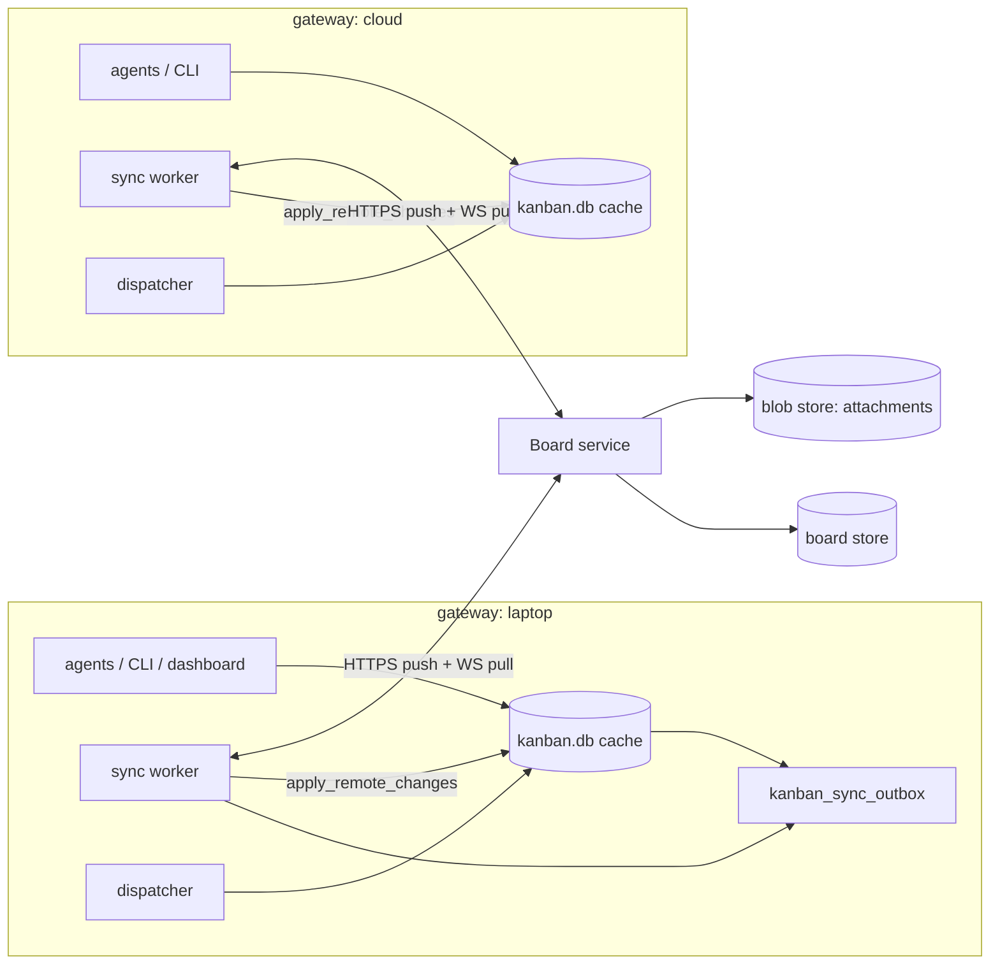
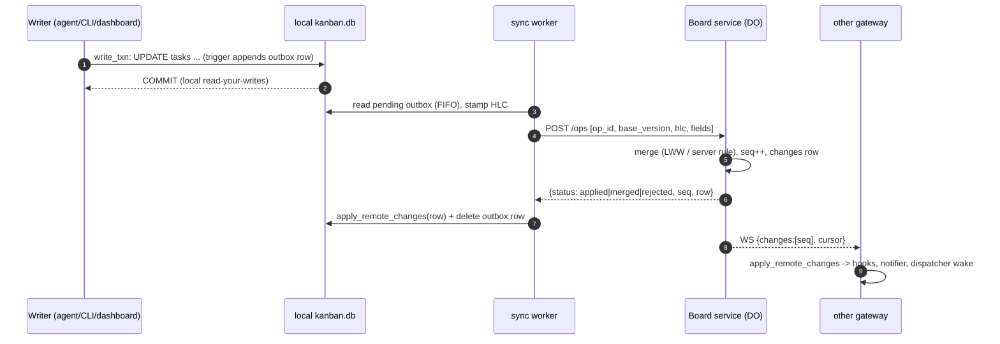

# Centralized sync service: Kanban, sessions and Inbox (design)

Patch: `0193` (core apply path) plus the sync client and a cloud service. **Phases 0–2 are built, and the `default`
board is in `primary` on every gateway since 2026-10-27**: the Board service is the source of truth, each gateway's
`kanban.db` holds its own cards and the replica holds the whole board. What is built is described
under Current state.

Status: design / RFC, 2026-10-23, widened 2026-10-26. It proposes one cloud source of truth for Kanban boards, the
sessions index and the Inbox, with every gateway keeping a full local cache that serves reads and accepts writes while
offline. Ownership is a lease in the source of truth. Work runs on worker nodes chosen by labels, and transcripts
sync end-to-end encrypted so any session opens from a local copy (Worker nodes and transcripts). This is now the
single plan: the private hub plan (v2, 2026-10-23) and the 2026-10-26 additions are folded in here. Shipped behavior is limited to what Current state,
Liveness and the "Built so far" note under Operations describe; everything else claims nothing that tests prove.

All line references are to upstream `hermes-agent` at `07ee800d` (2026-10-22) unless a path starts with `plugins/`
or `core/` in this repo.

## Current state (2026-10-26)

What runs today is a step toward this design, not this design. A sync service replicates each gateway's records
(sessions index, Inbox, Kanban tasks) into every other gateway's local replica. The gateway that owns a record is
still its authority. Other gateways read the replica and change a record by sending its owner a request. Core patch
0193 is not built, so cards still live in their home gateway's `kanban.db` and only run there.

Terms used below for the current system:

- **collector**: the client that reads a gateway's own sessions, Inbox and boards each sync cycle and publishes them.
- **`gateway/info`**: the one record each gateway publishes about itself. Its `task_scopes[]` lists every
  `profile/board` the collector tried to read this cycle, with `state` `ok` or `unknown`.
- **qualified key**: a task record keyed `profile/board/task`. Older records were keyed `board/task` (a two-part
  alias) and carry no profile.
- **home gateway**: the gateway whose `kanban.db` holds a card today. In the target design it is only the default
  first lease holder.
- **sessions index**: the synced sidebar metadata (title, status, links), not the transcript.

Because the owner is the authority, a chat on one gateway that hands work to another cannot just read whether that
work is done. It has to collect proof. That is what the origin ledger does
([kanban-origin-work-ledger.md](kanban-origin-work-ledger.md)): durable bindings, owner observations and release
receipts. It works, but it costs. Measured on 2026-10-26 on one personal gateway, from its sync log, its published
records and its error log (counts grow through the day as more boards publish):

1. Every sync republished every task, because a per-task "still alive" timestamp sat inside each hashed record.
   1,952 of 1,954 changed records per 75 s cycle were only that stamp. Fixed, see Liveness.
2. Every reader reconciled two association paths and wrote the result back to a snapshot on the read path. That
   write failed with `database is locked` 149 times in a day, and each time the sidebar showed every row as
   unknown. Fixed in core (one shared projection per store state, best-effort snapshot;
   `test_kanban_remote_inventory_cache.py`).
3. Remote work does not shrink. 3,944 remote links resolve to 2,095 distinct session/card pairs, because 1,849
   links come from old two-part `board/task` alias records (see Legacy two-part aliases). And 821 qualified links
   whose owner reported done stay unfinished, because no release receipt exists for them.

1 and 2 were fixes inside the current design. 3 is structural: with per-gateway authority a remote "done" is a claim
to verify. With one source of truth it is the card's status.

### Central Kanban sync: built so far (2026-10-27)

- **Phase 0, the Board service** (the service repo's per-board Durable Object): deployed. Since 2026-10-27 it also
  accepts **row ops**, the push format in Sync protocol (`{op: upsert|delete, table, uid, fields, hlc}`), which is
  what the capture triggers record. A gateway runs its own card transitions, so the service stores the resulting
  rows instead of re-deriving them: tasks merge per field by HLC, child rows are keyed by uid, links by
  `parent>child`. The service keeps the two decisions only it can make: `created_on` (the creating gateway, set
  once; an `import` of an id another gateway created is refused `id_taken`) and leases (a row op that moves a card
  under another gateway's live lease is refused `live_claim`). Its task ops (`create`, `complete`, …) are unchanged.
  Tests: the service repo's `worker/test/rows.test.ts`.
- **Phase 1, core seams** (triggers, outbox, apply path, lease hooks): shipped behind `kanban.sync.enabled`.
- **Phase 2, the sync client** (`hermes_cli/kanban_sync_client.py`, `hermes kanban sync …`, a supervised gateway
  watcher, one gateway per host): pull first, then push the outbox as row ops; a cursor below the retention floor
  rebuilds from a paged snapshot. Every synced board keeps a **replica** of the whole board in
  `<root>/kanban/sync-shadow/<board>.db`, applied with no hooks. In `shadow` mode the live board stays local and
  `hermes kanban sync diff` compares this gateway's live cards with the replica. In `primary` mode the live board
  also takes this gateway's own cards from the feed (edits made elsewhere, lease changes) and claims through service
  leases. It never takes another gateway's cards, so the dispatcher's sweeps (stale claims, orphans, concurrency
  counts) never see foreign work; cross-gateway reads come from the replica. The switch and `kanban.sync.boards`
  are read from the kanban root's `config.yaml`, because kanban storage is shared by every profile on a host.
  Tests: `test_kanban_sync_client.py` (against an in-memory fake of the service contract), plus the phase 1 suites.

Live since 2026-10-27: the `default` board syncs in `shadow` on all three gateways (import: 162k, 46k and 0.5k
rows; every `sync diff` clean, sampled hourly into `~/.hermes/logs/kanban-sync-soak.jsonl`). `primary` was run end
to end on a test board: cards created on the hub and on the mini were claimed through Board leases, run by real
workers and completed; the other gateways' replicas followed within about 10 s (5 s polling on both ends); their
live boards never took the card; a status move by a non-holder was refused `live_claim`; an edit from another
gateway landed on the owner's live board; a holder's `done` ends its lease. On 2026-10-27, at the owner's
request, `default` was cut over to `primary` on all three gateways ahead of the planned 24 h soak (about 40 min of
clean samples on the final code, plus the end-to-end test); every claim since goes through a Board lease, with no
rejected ops and clean diffs. Known: a claim can race the push of its card's creation
(one deferred tick); the service stalled 15–18 s around a deploy (likely the Durable Object restarting onto new
code). A lease granted for a claim whose local CAS then lost is handed back at once (`ClaimGate`), and the Board's
release ends the run the grant created.

Run rows left `running` (fixed 2026-10-27, kanban t_01a17fd938a6621c). Child rows have no per-field clocks, so the
last write wins wherever it lands, and child rows push whole. A run that ended within one sync round of an earlier
write of the same row came back `running`: the pull applied the feed copy of an older state of the row (our own
earlier op, whose outbox row the push had already deleted, or the Board's lease-grant copy) over the newer local
row, and the push then sent the clobbered row to the Board. The card had moved on, so nothing reached the run again;
the MacBook, hub and mini had 12, 5 and 1 such rows. Fixed on both sides:
- core: the apply path skips a feed copy of a child row while a local edit of it is still in the outbox, and a
  `task_runs` copy at or below `task_runs.sync_version` (the Board version this gateway last applied or had
  acknowledged; local-only column). The dispatcher's orphan pass also closes any run still `running` that is no
  longer its card's current run and is over 10 min old (`close_dangling_runs`), and the sync pushes that close.
  Tests: `test_kanban_sync_run_rows.py` (stale-lock reclaim, orphan sweep, a run ending before its first push, a
  grant whose local CAS lost, a newer Board write still landing, the sweep).
- Board (hermes-hub#32): `expireLease` ends the lease's run even when the card already moved on, and a holder's row
  op that moves its card out of `running` ends the lease's run before clearing the lease (the gateway's own end of
  the run, normally in the same batch, overwrites it). `wake_at` in `scheduled`/`continued` payloads and run
  metadata is now seconds, as core reads it. Tests: `worker/test/lease-runs.test.ts`.
The claim kill that made these races common (an older feed copy dropping the lease mirror, plus a stale
`last_heartbeat_at` from the previous run, reclaimed fresh workers about 5 s after spawn) was fixed earlier in core
36df211821 (`test_kanban_sync_lease_fencing.py`, `test_kanban_claim_heartbeat_reset.py`).

After the cutover the hourly diffs caught one real defect: every process's first connect dropped and recreated
the capture triggers with no transaction around it, so a write from another process in that window (a claim's run
row right after a gateway restart) was never captured. Fixed: the install runs in one write transaction, is a no-op
when the triggers already match, and on an attached board queues any row it finds written without capture
(`test_kanban_sync_client.py`, capture gaps). The rows missed before the fix were re-imported; all three diffs are
clean in `primary`.

Linked cards (the Desktop strip above the composer): the remote-links projection no longer makes readers wait on its
rebuild (`/api/session-kanban-tasks` went from 11–19 s to under 40 ms on a busy gateway), and the session-tasks plugin
paints a chat's last-known cards from a per-chat cache the moment it is opened, loads each source independently and
shows each card as a row (status, title, assignee, latest activity, note, PR link).

Phase 5, chat links on the Board (2026-10-27): which chats a card belongs to now syncs like any other row, in a
`task_chat_links` table (uid `task:gateway:profile:session:kind`, kind `created` or `shepherd`, a `released` flag).
Each gateway's sync loop reconciles its own links every 60 s from its local data (`tasks.session_id`, tui
subscriptions) and from the origin ledger, and pushes the difference. A board that only another gateway has gets a
link-only file in `<root>/kanban/sync-links/`, so links to cards created elsewhere still have somewhere to live.
`hermes kanban sync links-diff` compares, per chat, the open remote cards the ledger lists with the ones the
replicas list. It was clean on all three gateways (1076, 8 and 202 links) before the readers switched:
`kanban.sync.links_reader: replica` is set everywhere, and the Desktop's linked cards for another gateway's work now
come from the local replica, with no call to that gateway. The ledger stays as the fallback (unset the key to go
back). The endpoint opens every board and replica once and keeps the read-only connections, so one chat's cards take
1–2 ms on the laptop and the mini and 1–5 ms on the hub (it was about 40 ms with a 120–340 ms tail when it opened
16 files per call). Tests: `test_kanban_chat_links.py`, `test_kanban_ro_cache.py`.

Boards: every board on every host is attached and `primary` (6 on the laptop, 4 on the mini, 5 on the hub). Boards a
host only knows through links (the laptop's `bb`, `runners` and `unconventional-collab`) keep just a replica. The sync loop now wakes on the service's WebSocket
feed, on a local outbox write or on its period, instead of polling every 5 s.

What is not built yet: Desktop reading whole boards from the replica (only linked cards do), and placement beyond
"a card runs where it was created" (`runs_on`, Worker nodes and transcripts).

## Problem

As of 2026-10-23, before the replication described above. The board model below is still true; the "nothing is
replicated" view model is not, but replication alone did not give one source of truth.

A board is a SQLite file on one machine. `hermes_cli/kanban_db.py` L1–12 states the model: boards live under
`kanban_home()` (L400; `HERMES_KANBAN_HOME` or the Hermes root, shared by every profile on the host), each board is
`<root>/kanban/boards/<slug>/kanban.db` (`kanban_db_path` L562, `default` stays at `<root>/kanban.db`), and
concurrency is WAL plus `BEGIN IMMEDIATE` plus a compare-and-swap on `tasks.status`/`claim_lock`
(`hermes_cli/kanban_db_connect.py` `write_txn` L1241, `hermes_cli/kanban_db.py` `_claim_and_open_run` L2123). That
gives one writer per board, which is the whole correctness story for claims: "at most one concurrent writer
succeeds" (`write_txn` docstring).

With several gateways (laptop, mac-mini, a cloud gateway), each one has its own, unrelated boards:

- Patch 0090 ([kanban-all-gateways.md](kanban-all-gateways.md)) merges boards at view time in Desktop only
  (`apps/desktop/src/plugins/kanban/api.ts`: `mergeBoards`, `remoteRead`, `taskOwners`). Its Gotchas say it plainly:
  "Nothing is replicated. Each gateway keeps its own kanban.db". Upstream `api.ts` L11–12 still says "a board lives on
  ONE gateway". Agents, the CLI, the dispatcher and the notifier see only their own host.
- Agents reach other gateways' cards through `cross_task` (`plugins/session-mentions/__init__.py` L131–180), which
  writes a request file that the Desktop app relays (L1–6, `_relay` L191). It works only while Desktop is running, and
  it can list/read/comment only.
- A parent card cannot depend on a child that runs on another gateway: `task_links` (L879) holds plain local ids and
  `_parents_satisfied` (L2099) reads local rows.
- Moving a board is export/import (`hermes_cli/kanban_transfer.py`): `_scrub_local_state` (L70) strips claims, PIDs
  and notify subs, and an import always lands as a new board (`import_board` L287), so there is no shared history.

## Goals

- One logical board, visible and writable from every gateway, the CLI, agents and Desktop, with the same task ids
  everywhere.
- Every existing local reader keeps working unchanged: SQL against `kanban.db`, the dashboard REST plugin
  (`plugins/kanban/dashboard/plugin_api.py`), the WebSocket event tail (L1802), and this repo's plugins that open the
  file directly.
- Offline first: a gateway with no network keeps reading and writing its cache and converges when it reconnects.
- Claims stay exclusive across gateways. Two gateways must never run the same card at once.
- Cross-gateway dependencies (parent on laptop, child on the cloud gateway) work natively.
- Attachments are reachable from every gateway.
- The rollout is incremental and reversible (feature flag, shadow mode, one-command rollback to local-only).
- The sessions index (sidebar metadata) and the Inbox live in the same service, so every machine shows the same
  sidebar and Inbox, from its own cache.
- When a gateway is gone, its work can be taken over, without ever running a card twice (Ownership).
- "Is this chat's remote work done" is a local read of the card, not a proof collected from another gateway.
- Work runs where it can (any cloud node, a Mac with Xcode, or one specific machine), and every session opens in
  under a second on every key device, from its local copy, wherever it runs (Worker nodes and transcripts).

## Non-goals

- Sending transcripts in the clear, replicating workspaces, or syncing chat ids. Transcripts sync end-to-end
  encrypted to key devices (Worker nodes and transcripts): the service stores ciphertext only. Session *metadata* (title, status, links) syncs in
  the clear. Workspaces stay on the node that runs the work and move only as explicit snapshots.
- Server-side search of transcripts. Search stays local, over each device's decrypted copy.
- Multi-tenant SaaS. This is one owner's boards, a handful of gateways and at most tens of thousands of cards.
- Real-time collaborative text editing of card bodies. Field-level last-writer-wins is enough.
- Replacing the dispatcher. Each gateway still runs its own embedded dispatcher
  (`gateway/kanban_watchers_dispatcher.py` `_KanbanDispatcher` L121) against its local cache.
- Peer-to-peer sync between gateways. A star topology around one service is much simpler to reason about for leases.

## Architecture



- **Service**: owns the canonical rows, assigns a monotonically increasing server sequence (`seq`) per board, grants
  claim leases and serves a change feed.
- **Local cache**: the existing `kanban.db`, schema unchanged except for added columns and tables (below). Every
  read stays local. Every write still commits locally first, in the same `write_txn`, and also appends an outbox
  row in that transaction.
- **Sync worker**: one per gateway, running in the gateway process beside the embedded dispatcher
  (`gateway/kanban_watchers.py` L258). It drains the outbox, holds a feed subscription per synced board, and applies
  remote changes through the new core entry point `kanban_db_sync.apply_remote_changes`.
- **Desktop**: talks to its active gateway exactly as today. Because every gateway's cache holds every synced board,
  the 0090 fan-out becomes unnecessary (see Migration).

### Option A: Cloudflare (recommended)

- **Workers** for the HTTP API: auth, request validation, routing to the board object.
- **One Durable Object per board**, using SQLite-backed storage (GA since 2025-04; 10 GB per object on Workers Paid,
  which is orders of magnitude above a board's size). A DO is single-threaded and strongly consistent, which mirrors
  today's single writer per board. Claim CAS, `seq` assignment and the feed all live in one object with no
  distributed locking. The DO's schema can be close to `SCHEMA_SQL`, so server logic can be ported from
  `kanban_db.py` instead of re-modelled.
- **Push** through the DO WebSocket Hibernation API (`ctx.acceptWebSocket`): idle boards cost nothing, and up to
  32,768 sockets per object is far beyond a few gateways. DO alarms handle lease expiry and tombstone GC.
- **D1** only for the small cross-board index: the board list, gateway registry and token hashes. Board data stays in
  the DOs.
- **R2** for attachments. Gateways upload and download through short-lived presigned URLs minted by the Worker.
- Ops: one `wrangler deploy`. There is no VPC, no connection pool, and no cold-start penalty on the hot path.

### Option B: AWS

- **API Gateway** (HTTP API for push and pull, WebSocket API for the feed) plus **Lambda**.
- **Aurora Serverless v2 (Postgres)**: one schema, a `board_id` column on every table, `SELECT … FOR UPDATE` or a
  conditional `UPDATE` for claims, and a per-board sequence. It is relational like `SCHEMA_SQL`. Costs: a VPC, RDS
  Proxy for Lambda connection storms, and a minimum ACU floor.
- **or DynamoDB**: one item per row with `pk=board#…`, conditional writes for claims, and Streams to fan out to
  WebSocket connections that are tracked in a table. It is cheap and serverless, but every relational read (links,
  `recompute_ready` on L2035, board listing) has to be re-modelled into access patterns, and the per-board total
  order needs an atomic counter item.
- **S3** for attachments, again with presigned URLs.
- Ops: IaC across about six services. The WebSocket fan-out needs a connection table, and push must be done by
  calling `postToConnection` from Lambda.

### Comparison

| Concern | Cloudflare Workers + DO | AWS Lambda + Aurora | AWS Lambda + DynamoDB |
|---|---|---|---|
| Per-board serialization (claims, `seq`) | native (single-threaded DO) | row locks / sequence | conditional writes + counter item |
| Schema reuse from `SCHEMA_SQL` | high (SQLite) | high (SQL) | low |
| Live push | DO WebSocket, hibernates | API GW WS + connection table | API GW WS + Streams |
| Idle cost | ~0 | ACU floor + proxy | ~0 |
| Ops surface | 1 deploy, 4 products | VPC, RDS Proxy, IaC | IaC, stream wiring |
| Cross-board queries | weak (fan-out to DOs; D1 index) | strong | weak |
| Vendor lock-in | DO API | low (Postgres) | high |

**Decided: Cloudflare** (the existing service runs there). Original reasoning: The problem is "many small, independent, strictly ordered logs with exclusive
leases", and one Durable Object per board is exactly that primitive. The DO's SQLite keeps the server schema a near
copy of the client's, and hibernating WebSockets make live push essentially free. AWS + Aurora is the fallback if
cross-board SQL analytics or Postgres portability ever matter more. Keep the wire protocol (below)
backend-agnostic so that switching later costs one server rewrite and no client changes.

### Auth and tokens

- **Gateway identity**: each gateway registers once (`hermes kanban sync enroll`). Enrollment is approved from an
  already-enrolled device or with a one-time code, and it yields a `gateway_id` (ULID) plus a long-lived refresh
  token. The token is stored in the gateway's secret store (the same place provider keys live, never in
  `kanban.db`, never in this repo). Each request uses a short-lived access token (≈15 min JWT) that carries
  `gateway_id` and the board scopes.
- **Profile identity**: profiles share one board root per host (`kanban_home()` L400), so the gateway is the
  security principal and the profile is an attribution field (`created_by`, `author`, `task_runs.profile`). The
  service records which gateway wrote what (`origin_gateway`) but does not try to authenticate individual profiles.
- **Scopes**: `board:read`, `board:write` and `board:claim` per board, plus a global `operator` scope (lease reset,
  enroll, revoke) held by the owner's devices only. A read-only gateway (for example a phone
  companion) never gets `claim`.
- **Revocation**: deleting the gateway row in the D1 registry invalidates its refresh token, and every request also
  checks the registry, so its unexpired access token stops working at once. Its outstanding leases expire normally
  (see Claims); a revoked machine's sessions are reassigned (Worker nodes and transcripts).
- **Attachments**: the service never proxies bytes. It returns presigned R2/S3 URLs scoped to
  `boards/<board_id>/attachments/<attachment_uid>` that expire in 5 minutes.

## Data schema

### Current schema (verbatim, `hermes_cli/kanban_db.py` `SCHEMA_SQL` L775–981, column comments stripped)

```sql
CREATE TABLE IF NOT EXISTS tasks (
    id                   TEXT PRIMARY KEY,
    title                TEXT NOT NULL,
    body                 TEXT,
    assignee             TEXT,
    status               TEXT NOT NULL,
    priority             INTEGER DEFAULT 0,
    created_by           TEXT,
    created_at           INTEGER NOT NULL,
    started_at           INTEGER,
    completed_at         INTEGER,
    workspace_kind       TEXT NOT NULL DEFAULT 'scratch',
    workspace_path       TEXT,
    branch_name          TEXT,
    project_id           TEXT,
    claim_lock           TEXT,
    claim_expires        INTEGER,
    tenant               TEXT,
    result               TEXT,
    idempotency_key      TEXT,
    consecutive_failures INTEGER NOT NULL DEFAULT 0,
    worker_pid           INTEGER,
    worker_started_at    INTEGER,
    last_failure_error   TEXT,
    max_runtime_seconds  INTEGER,
    last_heartbeat_at    INTEGER,
    current_run_id       INTEGER,
    workflow_template_id TEXT,
    current_step_key     TEXT,
    skills               TEXT,
    model_override       TEXT,
    provider_override    TEXT,
    reasoning_effort     TEXT,
    max_retries          INTEGER,
    goal_mode            INTEGER NOT NULL DEFAULT 0,
    goal_max_turns       INTEGER,
    session_id           TEXT,
    block_kind           TEXT,
    block_recurrences    INTEGER NOT NULL DEFAULT 0
);

CREATE TABLE IF NOT EXISTS task_links (
    parent_id  TEXT NOT NULL,
    child_id   TEXT NOT NULL,
    PRIMARY KEY (parent_id, child_id)
);

CREATE TABLE IF NOT EXISTS task_comments (
    id         INTEGER PRIMARY KEY AUTOINCREMENT,
    task_id    TEXT NOT NULL,
    author     TEXT NOT NULL,
    body       TEXT NOT NULL,
    created_at INTEGER NOT NULL
);

CREATE TABLE IF NOT EXISTS task_events (
    id         INTEGER PRIMARY KEY AUTOINCREMENT,
    task_id    TEXT NOT NULL,
    run_id     INTEGER,
    kind       TEXT NOT NULL,
    payload    TEXT,
    created_at INTEGER NOT NULL
);

CREATE TABLE IF NOT EXISTS task_runs (
    id                  INTEGER PRIMARY KEY AUTOINCREMENT,
    task_id             TEXT NOT NULL,
    profile             TEXT,
    step_key            TEXT,
    status              TEXT NOT NULL,
    claim_lock          TEXT,
    claim_expires       INTEGER,
    worker_pid          INTEGER,
    worker_started_at   INTEGER,
    max_runtime_seconds INTEGER,
    last_heartbeat_at   INTEGER,
    started_at          INTEGER NOT NULL,
    ended_at            INTEGER,
    outcome             TEXT,
    summary             TEXT,
    metadata            TEXT,
    error               TEXT
);

CREATE TABLE IF NOT EXISTS task_attachments (
    id           INTEGER PRIMARY KEY AUTOINCREMENT,
    task_id      TEXT NOT NULL,
    filename     TEXT NOT NULL,
    stored_path  TEXT NOT NULL,
    content_type TEXT,
    size         INTEGER NOT NULL DEFAULT 0,
    uploaded_by  TEXT,
    created_at   INTEGER NOT NULL
);

CREATE TABLE IF NOT EXISTS kanban_notify_subs (
    task_id       TEXT NOT NULL,
    platform      TEXT NOT NULL,
    chat_id       TEXT NOT NULL,
    thread_id     TEXT NOT NULL DEFAULT '',
    user_id       TEXT,
    user_id_alt   TEXT,
    chat_type     TEXT,
    notifier_profile TEXT,
    delivery_mode TEXT NOT NULL DEFAULT 'notify',
    delivery_metadata TEXT,
    created_at    INTEGER NOT NULL,
    last_event_id INTEGER NOT NULL DEFAULT 0,
    last_ping_event_id INTEGER NOT NULL DEFAULT 0,
    PRIMARY KEY (task_id, platform, chat_id, thread_id)
);
-- indexes: idx_tasks_status, idx_links_child, idx_links_parent, idx_comments_task, idx_events_task,
--          idx_runs_task, idx_runs_status, idx_attachments_task, idx_notify_task
```

The idempotent column migrations in `kanban_db_connect.py` (`_BASE_TASK_COLUMNS` ~L820, the canonical
`CREATE TABLE`s L1058–1095) must keep matching. Patches in this repo add local tables
(`worker_recovery_sessions`, patch 0117) and derive state from `task_runs.metadata` (shared blockers, patch 0141,
"No schema change" in [kanban-shared-blockers.md](kanban-shared-blockers.md)). That derivation only works across
gateways if `task_runs` is synced.

### Identity: global ids without breaking local integer ids

`task_comments`, `task_events`, `task_runs` and `task_attachments` use `INTEGER PRIMARY KEY AUTOINCREMENT`, and
several things depend on those local integers being dense and monotonic:

- the notifier cursor `kanban_notify_subs.last_event_id` (`kanban_db_notify.py` L364 advances it under
  `BEGIN IMMEDIATE`);
- the dashboard WebSocket `since` cursor (`plugin_api.py` `stream_events` L1802);
- `tasks.current_run_id`, `task_events.run_id` and `HERMES_KANBAN_RUN_ID` in the worker env
  (`kanban_db_dispatch.py` L2833).

So the design **keeps the local integer `id` as a local surrogate** and adds a global `uid TEXT UNIQUE` (UUIDv7,
which is time-ordered and sorts like a ULID) to each of those tables. On the wire, rows are identified only by `uid`.
Integer cross-references (`run_id`, `current_run_id`) travel as `run_uid` and are translated to the local integer on
apply. A remote event therefore gets a fresh local `id` larger than every existing one, so every local cursor keeps
working without changes.

Task ids are already `TEXT`, but `_new_task_id` (L987) is `"t_" + secrets.token_hex(4)`: 32 bits, "collision ~1e-3
at 100k tasks", per gateway. Across gateways and offline creation that is not safe enough. New ids become
`t_` + 16 hex digits (64 bits, the first 48 of them a millisecond timestamp, so ids stay roughly sortable). Existing
`t_xxxxxxxx` ids are kept verbatim. The service rejects a colliding create with `409 id_taken`, and the client then
remaps (see Backfill). Links in chat (`@task:<board>/<task_id>`) keep working because ids never change once
accepted.

### Central schema (service side, per board)

Every synced table gains the same sync envelope:

```sql
-- added to tasks, task_links, task_comments, task_events, task_runs, task_attachments (server side)
uid             TEXT PRIMARY KEY,   -- tasks: = id ('t_…'); links: parent_id||'>'||child_id; others: UUIDv7
seq             INTEGER NOT NULL,   -- per-board server sequence of the LAST change to this row (feed cursor)
version         INTEGER NOT NULL,   -- bumps on every accepted change; used for optimistic concurrency
updated_at      INTEGER NOT NULL,   -- server wall clock, ms
hlc             TEXT NOT NULL,      -- hybrid logical clock of the winning write: '<ms:13>-<counter:4>-<gateway_id>'
origin_gateway  TEXT NOT NULL,      -- gateway_id that made the winning write
deleted_at      INTEGER             -- tombstone; NULL = live
```

`tasks` additionally keeps a per-field clock so concurrent edits to different fields both survive:

```sql
field_hlc       TEXT NOT NULL DEFAULT '{}'  -- JSON {column: hlc} for LWW-merged columns
lease_holder    TEXT,                       -- gateway_id holding the claim lease (server-only truth)
lease_run_uid   TEXT,
lease_expires   INTEGER                     -- server ms
```

The change log is the feed:

```sql
CREATE TABLE changes (
    seq         INTEGER PRIMARY KEY,         -- dense, per board (per DO)
    table_name  TEXT NOT NULL,
    row_uid     TEXT NOT NULL,
    op          TEXT NOT NULL,               -- 'upsert' | 'delete' | 'lease'
    fields      TEXT,                        -- JSON of changed columns AFTER merge (full row on insert)
    hlc         TEXT NOT NULL,
    origin_gateway TEXT NOT NULL,
    client_op_id TEXT,                       -- echo suppression + idempotency
    created_at  INTEGER NOT NULL
);
CREATE TABLE applied_ops (                   -- idempotency: replayed batch -> same result
    client_op_id TEXT PRIMARY KEY,
    result       TEXT NOT NULL,              -- JSON of the per-op response
    created_at   INTEGER NOT NULL            -- GC after 30 days
);
CREATE TABLE board_meta (key TEXT PRIMARY KEY, value TEXT);  -- board.json equivalent (name, archived, …)
```

**Columns that never leave the gateway.** They are machine-local, the same set `_scrub_local_state`
(`kanban_transfer.py` L70) already strips, plus a few more. They are stored locally and are neither pushed nor
overwritten by pulls:

| Table | Local-only columns | Why |
|---|---|---|
| `tasks` | `claim_lock`, `claim_expires`, `worker_pid`, `worker_started_at`, `last_heartbeat_at`, `workspace_path`, `session_id`, `project_id` | `host:pid` claimer (`_claimer_id` L993), local PIDs, local paths, local session ids. Lease state is synced through the server's `lease_*` columns instead. |
| `task_runs` | `claim_lock`, `claim_expires`, `worker_pid`, `worker_started_at`, `last_heartbeat_at` | same; the run's `status`, `outcome`, `summary`, `metadata`, `error`, `profile`, `step_key`, `started_at`, `ended_at` ARE synced |
| `task_attachments` | `stored_path` | absolute local path; the server stores `blob_key`, and the local path is filled in when the blob is fetched |
| `kanban_notify_subs` | the whole table | chat ids per gateway platform (and private); each gateway notifies its own chats |
| `worker_recovery_sessions` (0117) | the whole table | local transcript recovery |

`consecutive_failures` and `last_failure_error` ARE synced. Retry budgets are a property of the card, not of the
host, so a card that fails on one gateway must not get a fresh budget on another.

### Local additions (client side, in `kanban.db`)

```sql
ALTER TABLE task_comments    ADD COLUMN uid TEXT;  -- + UNIQUE index; same for task_events, task_runs, task_attachments
ALTER TABLE task_attachments ADD COLUMN blob_key TEXT;
ALTER TABLE tasks            ADD COLUMN sync_version INTEGER;  -- last server version seen (NULL = never synced)
ALTER TABLE tasks            ADD COLUMN field_hlc TEXT;        -- local per-field clocks (JSON)
ALTER TABLE tasks            ADD COLUMN lease_holder TEXT;     -- mirror of the server lease, read-only locally
ALTER TABLE tasks            ADD COLUMN lease_expires INTEGER;

CREATE TABLE kanban_sync_outbox (
    op_id       TEXT PRIMARY KEY,            -- UUIDv7 = idempotency key
    table_name  TEXT NOT NULL,
    row_uid     TEXT NOT NULL,
    op          TEXT NOT NULL,               -- 'upsert' | 'delete' | 'claim' | 'release' | 'heartbeat'
    fields      TEXT NOT NULL,               -- JSON: changed column -> new value (synced columns only)
    base_version INTEGER,                    -- row version the edit was made on
    hlc         TEXT NOT NULL,
    created_at  INTEGER NOT NULL,
    attempts    INTEGER NOT NULL DEFAULT 0,
    last_error  TEXT,
    state       TEXT NOT NULL DEFAULT 'pending'   -- 'pending' | 'inflight' | 'rejected'
);
CREATE INDEX idx_outbox_pending ON kanban_sync_outbox(state, created_at);

CREATE TABLE kanban_sync_tombstones (        -- rows deleted locally or remotely; the row itself is removed
    table_name  TEXT NOT NULL,
    row_uid     TEXT NOT NULL,
    deleted_at  INTEGER NOT NULL,
    PRIMARY KEY (table_name, row_uid)
);

CREATE TABLE kanban_sync_state (             -- one row per board file
    board_id      TEXT PRIMARY KEY,          -- server board id (ULID)
    cursor        INTEGER NOT NULL DEFAULT 0,-- last server seq applied
    gateway_id    TEXT NOT NULL,
    hlc_last      TEXT NOT NULL,             -- clock state, survives restart
    mode          TEXT NOT NULL,             -- 'off' | 'shadow' | 'primary'
    applying      INTEGER NOT NULL DEFAULT 0 -- 1 while apply_remote_changes runs (echo suppression)
);
```

**Capture by triggers, not by call sites.** Writes come from many places: `kanban_db.py` helpers, `plugin_api.py`
field editors doing direct SQL (the reason `notify_task_updated` L211 exists), CLI subprocesses (user-steps shells
out to `hermes kanban create`, `plugins/user-steps/cards.py` L1–5) and workers in other processes. Instrumenting
each call site would miss some. Instead, `init_db` (L804) installs `AFTER INSERT/UPDATE/DELETE` triggers on the
synced tables. The triggers write the synced columns into `kanban_sync_outbox` in the **same transaction** as the
change, which is the outbox pattern without any dual-write gap. Each trigger is guarded by
`WHEN (SELECT applying FROM kanban_sync_state) = 0` so remote applies do not echo. Triggers cannot compute an HLC,
so they store `hlc = ''`; the sync worker stamps the HLC when it drains the row, which is acceptable because the
outbox is FIFO per gateway, and the HLC only needs to be monotonic per gateway and above the last HLC observed from
the server.

## Sync protocol

Wire format: JSON over HTTPS. All timestamps are ms. `board_id` is in the path.

### Push (outbox drain)

`POST /v1/boards/{board_id}/ops` with up to 200 outbox rows in FIFO order:

```json
{"gateway_id": "01J…", "ops": [
  {"op_id": "0192…", "table": "tasks", "uid": "t_0192a1b2c3d4e5f6", "op": "upsert",
   "fields": {"title": "…", "priority": 2}, "base_version": 7, "hlc": "1761200000123-0003-01J…"}]}
```

The response has one entry per op: `{"op_id", "status": "applied"|"merged"|"rejected", "seq", "version", "row"}`.
`merged` means the server combined the op with a concurrent change, and `row` is the authoritative result, which
the client applies locally exactly like a pulled change. `rejected` carries a reason (`lease_lost`,
`illegal_transition`, `id_taken`, `forbidden`). The client marks those outbox rows `rejected`, applies `row` to
revert the local state, and writes a `sync_rejected` `task_event` so the board shows what happened.

The server treats `op_id` as the idempotency key (`applied_ops`), so a retried batch after a timeout returns the
same answers. Ops in one batch are applied in order. One op failing does not abort the batch, except that ops on the
same `uid` after a rejected op are also rejected (`depends_on_rejected`) so the per-row order is preserved.

### Pull (change feed)

- `GET /v1/boards/{board_id}/changes?after=<cursor>&limit=500` returns `{changes: [...], cursor, more}`.
- `GET /v1/boards/{board_id}/feed?after=<cursor>` upgrades to a WebSocket. The server first replays everything
  after `cursor`, then streams live changes: `{"type": "changes", "changes": [...], "cursor": N}`. It also sends
  `{"type": "lease", …}` frames and a `ping` every 30 s.
- SSE (`Accept: text/event-stream`) has the same semantics, for hosts whose proxies break WebSockets.
- Polling fallback: if the socket has been down for more than 10 s, poll `/changes` every 15 s (Desktop's 0090
  cadence) with backoff to 120 s, and keep trying to reconnect the socket.
- The client applies each page through `apply_remote_changes` and advances `kanban_sync_state.cursor` **in the
  same transaction**, so a crash replays at most one page, and replay is idempotent because changes are keyed by
  `(uid, version)`.
- If `after` is older than the server's compaction horizon, the server answers `410 resync`, and the client runs a
  snapshot resync: `GET /v1/boards/{id}/snapshot` streams the full board at a `seq`, the client rebuilds the synced
  tables (keeping local-only columns by uid) and then resumes the feed.



### Offline queue and reconnect

Offline, the outbox simply grows. Reads and writes are fully local, and the dispatcher keeps running cards that
the gateway **already holds leases for** (see Claims). On reconnect:

```mermaid
sequenceDiagram
  autonumber
  participant S as sync worker
  participant DB as local kanban.db
  participant SVC as Board service
  S->>SVC: refresh token, GET /changes?after=cursor (pull FIRST)
  SVC-->>S: remote changes since disconnect
  S->>DB: apply_remote_changes (local-pending fields win locally until their ops resolve)
  S->>SVC: POST /ops (drain outbox in batches)
  SVC-->>S: applied / merged / rejected per op
  S->>DB: apply authoritative rows; rejected -> revert + sync_rejected event
  S->>SVC: open WS feed after=cursor
```

Pulling before pushing keeps the per-field merge honest. While a row has pending outbox ops, an incoming change
for a field that is also pending locally is merged by HLC on the client, using the same rule the server will use,
so the UI does not flicker between values. The server's answer to the push is final either way.

## Conflicts

The policy is a hybrid: **operations whose correctness depends on a single winner are server-authoritative; field
edits are per-field LWW by HLC; append-only rows are a union.**

### Per-field LWW (HLC)

Columns: `title`, `body`, `assignee`, `priority`, `tenant`, `branch_name`, `workspace_kind`, `skills`,
`model_override`, `provider_override`, `reasoning_effort`, `max_retries`, `max_runtime_seconds`, `goal_mode`,
`goal_max_turns`, `workflow_template_id`, `current_step_key`, `idempotency_key`, `runs_on` (Worker nodes and
transcripts, Placement).

- The HLC is `(physical_ms, counter, gateway_id)`. It is updated on every local stamp and on every received change
  (`max(local, remote)`), so a gateway with a skewed clock still orders after anything it has seen. The server
  refuses HLCs more than 5 minutes ahead of its own clock (`clock_skew`) so one bad clock cannot win every future
  write.
- The server keeps `field_hlc[col]` and accepts a field only if the incoming HLC is greater. Edits to different
  fields of the same card both survive. This matters because the dashboard edits `title`/`body` while a worker's
  `complete_task` writes `result`.
- The alternative, whole-row optimistic concurrency (`base_version` must match, else reject), is simpler but turns
  every concurrent edit into a user-visible error. `base_version` is still sent, and the server uses it for the
  transition rules below.

### Server-authoritative operations

- **Status transitions** (`status`, `started_at`, `completed_at`, `result`, `block_kind`, `block_recurrences`,
  `consecutive_failures`, `last_failure_error`, `current_run_id`). These are not merged by LWW. The server
  validates each op as a transition from the row's current status, using the same state machine as `kanban_db.py`
  (`complete_task` L2639, `block_task` L3124, `unblock_task` L3560, `archive_task` L3792, `recompute_ready` L2035).
  An op that is illegal from the current state is rejected (`illegal_transition`). Example: an offline gateway
  archives a card that another gateway completed meanwhile. `archive` from `done` is legal and applies. `complete`
  from `archived` is rejected, and the run's summary is still kept as a comment. A `complete`/`block` op must carry
  the run uid of the lease holder (below).
- **`created_on`**: the creating gateway id, set once by the server when the card is created and never changed.
  Placement's default uses it; `origin_gateway` cannot, because it records the last writer.
- **`recompute_ready`** (todo → ready when parents are done) runs on the server after any status change, because
  only the server sees every parent. Gateways stop promoting locally for synced boards; they still run it for
  `mode='off'` boards.

### Append-only tables merge trivially

`task_comments`, `task_events` and `task_runs` (inserts) and `task_attachments` are keyed by a UUIDv7 `uid` that
the writer generates, so concurrent inserts never collide and the merge is a set union. Order for display is
`created_at, uid`. `task_runs` rows are updated in place only by the lease holder (end of run: `status`,
`ended_at`, `outcome`, `summary`, `metadata`, `error`), so they have a single writer by construction.
`task_links` is a set keyed by `(parent_id, child_id)`: add/remove ops with tombstones, add-wins on concurrent
add/remove.

### Deletes and tombstones

`delete_task` (L3857) hard-deletes locally today. For synced boards it becomes a tombstone (`deleted_at`): the
server records `op='delete'` in `changes`. Locally the row is still removed physically, the trigger records a delete
op plus a `kanban_sync_tombstones` row, and later pulls of a tombstoned uid are dropped. Rules:

- A delete beats a concurrent field edit (delete-wins), but not a concurrent **claim**. A card under a live lease is
  not deleted until the lease ends; the op returns `merged`, and the delete is applied after release.
- Children of a deleted task: links are tombstoned with it, and `_parents_satisfied` treats a deleted parent as
  satisfied (the same as today's local behavior after delete).
- Tombstones are GC'd after 90 days (DO alarm). A client whose cursor is older than that gets `410 resync`.

### Claims: server-granted leases

This is the part that has to be exactly right: **two gateways must never run the same card.** Today the guarantee
is the local CAS in `_claim_and_open_run` (L2123), which is exclusive only within one file. For synced boards:

1. The dispatcher's `claim_task` (L2170) keeps its local `write_txn`, but before the CAS it asks the service for a
   lease: `POST /v1/boards/{id}/leases {task_uid, run_uid, gateway_id, ttl_s}`. The DO grants it only if
   `lease_holder IS NULL OR lease_expires < now`, and the task is `ready` (or `review` for
   `claim_review_task`) with parents satisfied. The grant is a `lease` change in the feed, so every other gateway
   immediately mirrors `lease_holder` and its dispatcher skips the card.
2. Only after the grant does the local CAS run (`claim_lock = host:pid`, as now). The worker env is unchanged
   (`kanban_db_dispatch.py` L2812–2852).
3. `heartbeat_claim` (L2290) also renews the lease, rate-limited to once per `ttl/3`. The lease TTL defaults to
   the claim TTL. If renewal fails because the network is down, the worker keeps running until `lease_expires`
   minus a safety margin (60 s); then the dispatcher stops the worker exactly as it would for a stale claim
   (`on_kanban_worker_stale_claim`), and the run ends with `outcome='lease_lost'`.
4. `complete`/`block`/`release` ops carry `run_uid`. The server accepts them only from the current lease holder;
   from anyone else they are rejected with `lease_lost`, and the run's summary is preserved as a comment. This is
   the fencing token: a gateway that wakes up from a long sleep cannot overwrite the result of the gateway that
   re-ran the card.
5. Lease expiry on the server (DO alarm) returns the card to `ready` and appends a `reclaimed` event, mirroring
   `reclaim_task` (L2474), so a dead gateway never strands cards.

**Offline claims are not allowed.** A gateway without a lease cannot start a card on a synced board; the dispatcher
logs `claim_deferred: offline` and leaves the card `ready`. Cards already running when the network drops continue
until their lease runs out (step 3). This trades availability for safety, deliberately: running a card twice can
double-push a branch or double-send a message, while waiting only delays work. A per-board setting
`offline_claims: "local-only"` could later allow claiming cards whose `assignee` profile exists only on this
gateway, but that is an open question, not part of v1. See Ownership: that question is now a per-card
`available` setting, out of v1.

**Cross-gateway dependencies become possible.** Because `task_links` and every task's status replicate, a parent
on the laptop board can depend on a child that the cloud gateway runs. The server's `recompute_ready` promotes the
parent when the child completes, the promotion arrives as a change, and the laptop's dispatcher, woken by the
apply path, claims it. No relay is needed.

### Ownership: availability, reset and sessions

The claim rules above are the model for all ownership. Three additions.

**Availability is a declared property, not a TTL.** "Keeps working when the service is down" and "can be taken over
when a gateway is down" conflict for any one card. If an offline holder keeps running and someone else takes over,
the card runs twice. So each card says which it wants:

- `at_most_once` (default): the rules above. No offline claims, a holder that cannot renew stops at
  `lease_expires` minus the safety margin, and only then can the card be claimed again. Anything that pushes a
  branch, sends a message or spends money stays here.
- `available`: the home gateway may claim offline. This needs a second lease mode that the claim rules above do not
  have: a lease the service accepts after the fact when no other lease was granted meanwhile, and rejects
  (`lease_lost`, reported) when one was. Only for work that is safe to repeat (no external side effects).

We start with every card `at_most_once`. That is the behavior this doc already specifies, so `available` (and its
lease mode) is a later opt-in, designed when a real card needs it, not a v1 requirement.

**Renewal is per run.** A lease is renewed by its worker's heartbeat (`heartbeat_claim`), never by a gateway-wide
heartbeat. A gateway whose sync process is alive but whose worker is hung must lose the lease.

**Reset is expiry, plus an operator override.** The service already returns an expired lease's card to `ready` (DO
alarm), so a dead gateway never strands work. On top of that, the operator (a principal with an `operator` scope,
added to Auth) can reset a lease before it expires, when the holder is known to be gone. Either way the card's next
claim gets a new `run_uid`, and the `run_uid` fencing in step 4 rejects the old holder's late writes. Gateways never
reset each other's leases. A gateway that cannot reach the service looks exactly like a dead one from outside.

An early reset gives up the at-most-once guarantee for that card: if the holder was alive after all, its worker
keeps running until its own lease deadline and its side effects can happen twice. Fencing only protects the
service's state. So an early reset is a deliberate operator decision, shown with that warning, and listed in Risks.

**Sessions.** A session's owner is the node it runs on, with an owner epoch rather than an expiring lease. Moves,
reassignment and fencing are in Worker nodes and transcripts ("Sessions on worker nodes"). Inbox cards have an owning
gateway, other gateways act on them by request, and they never move.

## Liveness (built 2026-10-26)

Liveness belongs to a source, not to a record.

Before, the owner stamped `observed_at` on every task record it published, and readers required that stamp to be
under 180 s old. Proving "I'm still here" meant rewriting every task every cycle: one gateway queued 3,927 records
per cycle, and the replica's WAL grew to 176 MB.

Now the collector writes one `observed_at` on each `gateway/info` `task_scopes[]` entry it read this cycle (state
`ok` only), and a task is live when its owner's scope heartbeat is under 180 s old and the record is current. An
unchanged task publishes an identical record. Readers still accept the old per-task stamp, for records published
before the switch. Measured after, from each gateway's sync log: 1 to 10 records per quiet cycle on the two
personal gateways, 22 to 36 on the always-on gateway that runs agents (real activity). Tests:
`test_kanban_origin_scope_heartbeat.py` (core) and `client/tests/test_scope_heartbeat.py` (service client).

In the target design this stays as "this gateway successfully read its boards this cycle", for the "last synced"
mark on each gateway's cards. It is different from the feed WebSocket's keepalive (Sync protocol), which only says
the connection is up. Neither is lease renewal (see Ownership). The rule to keep: nothing that changes every cycle goes inside a record whose hash
decides what syncs.

## Worker nodes and transcripts

Work should run where it can, and every session should open in under a second on every device. Today neither is
true.

Some work can run on any cloud machine, and we want several of those. Some needs a Mac (macOS or iOS builds,
simulators). Some has to run on one specific machine, for example to debug a problem on that laptop. And viewing a
session that runs on another machine is slow: Desktop opens SSH, starts a fresh dashboard process there and tunnels
to it, on almost every connection. Measured 2026-10-26 from Desktop's lifecycle log (`[ssh-lifecycle]` lines) and
by timing the sessions handler in-process on the host: 6 to 10 s to the cloud gateway and about 19 s to a Mac gateway
before the first request is served, while the sessions request itself takes 0.1 to 1.8 s there. The cost is the
per-connection process start on a busy host, not the session.

So we separate where work runs from where you view it.

### Terms

- **machine**: one physical or virtual host. It has one registry entry (below).
- **principal**: an enrolled credential on a machine. A machine can have several: its **gateway** (runs agent
  sessions and card runs, and submits workspace jobs) and, if it builds, a separately enrolled **workspace worker**
  (the contract's worker, whose credential job code cannot read).
- **worker node**: a machine that runs work, through any of its principals. Not to be confused with Cloudflare
  Workers (the service runtime), the sync worker (the client loop in Architecture) or a card's worker process (the
  dispatcher's child).
- **user device**: a machine the account owner works at (laptops, desktops). **Key device**: a machine holding
  transcript keys. User devices are key devices; a worker node that runs sessions is one too (it has to read the
  transcripts it extends).
- **account**: the one owner of all boards, sessions and machines (this is not multi-tenant).
- **session feed**: a session's append-only stream of transcript records, a collection on the service's existing
  replication feed.

### One machine registry for every kind of work

The runners plugin's workspace-job contract (`plugins/runners/contracts/workspace-jobs.md`) already specifies an
enrolled worker with least privilege, admission, holds, revocation, safe drain, receipts and mandatory sandboxing,
for build jobs over unpublished source. We keep that contract as the rules for workspace jobs and put every kind of
work on one **machine registry**, so a machine is described once.

A machine entry holds its labels (`linux`/`macos`, tools such as `xcode`, `simulators`, `gpu`, and
`machine:<name>`), a `pinned_only` flag, per-kind capacity, and its principals (gateway ids and workspace worker
ids). Labels and `pinned_only` are set by an operator action, never by the machine, so a machine cannot claim
another's `machine:` label. Leases are granted to a gateway id (Claims); the service finds that gateway's machine
entry and checks its labels and capacity there.

What is shared, and what is not:

- **Shared:** the registry entry, owner holds (a hold stops new work of every kind on the machine), revocation (it
  revokes every principal of the machine) and one append-only audit.
- **Per kind:** capacity (`workspace_slots` per the contract's slot accounts, §10 and §17.6; `max_sessions` and
  `max_card_runs` for agent work, checked by session assignment and the lease grant), heartbeats and loss timing.
  Workspace jobs keep the contract's heartbeat and loss rules (§9, §17.5), card runs keep Claims step 3, sessions
  keep the owner rules below. A machine's total load is visible in one place even though the counters differ.

| Kind | Who places it | Execution rules |
|---|---|---|
| workspace job | a grant binding submitter, worker and recipe (contract §2, enforced at §10) | the contract: sandboxed recipe, at most one launch per attempt (§8, §17.4), receipts |
| card run | the lease grant (Claims) plus the label check below | this doc's lease rules |
| session | assignment plus the label check below | owner epoch and self-fencing (Sessions on worker nodes) |

Least privilege holds: a session that delegates (below) acts through its gateway principal, which is a contract
*submitter*. It never acts as a workspace worker. The workspace worker principal still calls only
`workspace.worker.*`.

Batch work on committed source (builds, tests) can keep running as GitHub Actions jobs on the existing runners, which
the runners plugin already routes. We use the same vocabulary (`runs_on` labels, claim, lease renewal, drain) so the
two read alike, but sessions never go through GitHub: they are long-lived and interactive, their transcripts are
encrypted, and an Actions outage or billing hold must not stop them.

Two contract questions remain (Open questions): the contract runs `workspace.*` over a different hub than this
service, and it allows admin actions only from a local shell on that hub. This service has no shell. Its equivalent
is an operator action that also needs a signature from a user device (Keys), which is stronger than an Access login
alone.

**Which operator actions need a user-device signature.** Anything that widens access or can cause a double run:
setting labels or `pinned_only`, adding or revoking a machine, an early lease reset, an early session reassignment, a
move onto a `pinned_only` machine, and reassignment policies. The `operator` scope alone (Auth) covers read-only
views and actions that only narrow access, such as placing a hold.

### Placement

Sessions and cards carry `runs_on`, a list of labels that must **all** be present on the machine:

- **default:** the creating machine's labels minus its `machine:` label ("a machine like this one"). The creating
  gateway may claim at once; any other matching machine may claim when the work has been `ready` and unclaimed for
  `home_grace` (default 10 min) or the creator's heartbeat is stale. That keeps today's behavior (work runs where it
  was created) and still lets a dead gateway's work be taken over (Ownership).
- `[]`: any machine. Explicit opt-in. Cloud machines scale horizontally; leases already prevent two running one card.
- `[macos, xcode]`: any machine with both labels.
- `[machine:<name>]`: that machine only.

`runs_on` is a synced LWW column, and `created_on` (the creating gateway id) is set once by the server at create
(Per-field LWW, Server-authoritative operations). The lease grant (Claims, step 1) and every session assignment check
the machine's registry labels against `runs_on`. A `pinned_only` machine accepts only work whose `runs_on` names its
`machine:` label, so an arbitrary card never runs on a personal laptop with its files and logged-in accounts. Queue
depth of `[]` work is the signal to add a cloud machine.

### Delegate or migrate

Sometimes a session finds out mid-way that it needs something its machine lacks.

**Delegate (the default).** The session stays put and sends only the step that needs the capability: a card with the
right `runs_on`, plus a workspace snapshot (contract §6) when it needs unpublished edits. The snapshot follows the
contract's secret rules: a snapshot containing a secret-looking file is refused, never silently trimmed (§6.3). The
session waits for the card's result and carries on. Most "build and test this on a Mac" needs end here.

**Migrate (when the rest of the work needs the other machine).** The agent calls `request_move(runs_on)`, and at the
next turn boundary, never mid-tool-call:

1. Quiesce: finish the turn, stop or record background processes, and write a **handoff note**: what was running,
   how to restart it, and what will not move (processes, simulator state, files outside the workspace, `/tmp`).
2. Snapshot: publish the workspace snapshot (same rules as delegate) and confirm the session feed is fully synced.
3. Hand off: the service assigns the session to a matching machine and bumps the owner epoch (below). The new owner
   materializes the workspace and resumes from the feed.
4. Orient: the first turn there gets the handoff note as a new message. History and the system prompt are never
   edited, so the cached prompt prefix stays valid (if the new machine uses the same provider account it may still
   hit; otherwise the first turn pays a full cache miss).

Credentials never move: the new machine uses its own token broker. A move onto a `pinned_only` machine needs the
operator's approval each time; moves between pool machines can be automatic. Migration needs the session feed (W1)
and the registry (W3), so it arrives with W3.

### Sessions on worker nodes

A session's owner is the gateway it runs on: a pointer in the sessions index plus an **owner epoch**. Two rules keep
a session from running twice:

- **Fencing at the service.** Every transcript record and op the owner writes carries the epoch, and the service
  rejects anything with an older one.
- **Self-fencing at the owner.** The gateway heartbeat lists every session it owns with that session's signed head,
  and the service confirms ownership per session. The owner starts a turn only while its last *confirmed* heartbeat
  was *sent* less than `owner_ttl` (default 2 min) ago, measured on a clock that keeps running through sleep
  (`CLOCK_BOOTTIME` on Linux, `mach_continuous_time` on macOS). A turn is cut off at `max_turn_seconds`, and the
  cut-off stops the turn's whole process group, background processes included, before the turn counts as ended. An
  owner whose heartbeats go out but are not confirmed for `owner_ttl` stops heartbeating that session, so the service
  sees silence rather than a live owner that has stopped (a one-way partition cannot stall the session).

Because the owner measures from when it *sent* a heartbeat and the service from when it *received* it, the owner's
deadline is always earlier. Reassigning a session whose owner has gone silent waits `owner_ttl + max_turn_seconds +
60 s` after the last heartbeat received (the 60 s margin matches Claims step 3), then bumps the epoch. The new owner
reads the feed up to the newest signed head the old owner published and resumes from there; if records named by that
head are missing, it says so ("resumed from record N; head M unavailable"). Anything the old owner never synced is
lost, and the reassignment says so.

**Who may change the owner.** Every epoch change is a signed record in the session feed. A cooperative move is
signed by the old owner. Any other reassignment is signed by a user device, either directly or through a reassignment
policy a user device signed once ("pool sessions may be reassigned automatically after the timeout"). Readers check
that each record's signer is the owner of its epoch, and that each epoch change carries a valid signature for its
kind. Two chains for one epoch, or an epoch change without a valid signature, is a fork: readers show both and the
operator chooses. An operator can also reassign before the timeout, accepting that a still-running turn may repeat
its side effects (the same trade as an early lease reset); that also needs a user device's signature.

Revoking a machine (Revocation, below) immediately bumps the epoch of every session it owns and stops confirming its
heartbeats. Inbox cards keep their own rule: an owning gateway, other gateways act by request, no moves.

### Transcripts sync, end-to-end encrypted

Every message of a session (user turns, assistant turns, tool calls and results) becomes a record in the session
feed. The owner is the only writer of a session's feed: a user's message is a signed op addressed to the session
(not to an epoch, so it reaches whoever owns the session when it arrives), which the owner appends, user signature
included, in order. The appended record is the acknowledgement. The sender watches the feed for its op's uid,
marks the message "not delivered" if it does not appear within 30 s, and resends; ops are idempotent by uid. The
service can delay or drop ops, interrupts included, but not silently: the sender sees them undelivered. Records reach the service as soon as they are written (an
immediate push), not on the collector's 75 s cycle, and readers subscribe over the feed's WebSocket (the endpoint
exists; clients poll today). That is what makes live updates and sub-second opens possible.

User devices decrypt every feed into their own local `state.db`, so the transcript is effectively replicated, but
only to key devices. A worker node fetches only the feeds of sessions assigned to it; the service enforces that,
since until W4 one key opens every session. Sessions that existed before W1 are backfilled by their current owner
as **imported** records: signed by that owner, marked imported, starting a fresh chain. Readers show them as
imported rather than as records written live. Desktop renders any session
from the local copy with no connection to the machine running it, even offline. Large tool outputs, attachments and
workspace snapshots stored by the service go to the blob store, encrypted the same way. Search stays local.

**The device log.** An append-only log of devices, each entry (add, revoke, mark as user device, signed policy)
signed by an existing user device. Readers verify the whole chain from a pinned first entry, so the service can relay
the log but cannot add a device, change a key or promote a worker node to user device without a valid signature.

- **Genesis.** The first entry exists only after an explicit `init` run by the operator on a user device; that
  device creates the first entry, the data key and the recovery key (Backup). A device is never "first" because the
  service says no log exists: without `init`, a device that finds no log waits. The service refuses a second
  genesis for the account.
- **Pinning.** A device learns the genesis fingerprint during pairing, from the approving device, not from the
  service (it is one of the inputs to the short code below). A device given a forked log therefore fails pairing.

**Keys.** Device keys belong to the machine: one Ed25519 signing key and one X25519 encryption key per machine,
created when the machine is first enrolled and recorded on its registry entry. Every principal enrolled on that
machine later (its gateway through `sync enroll`, its workspace worker) attaches to the same entry, so one device-log
revoke covers all of them.

- The account **data key** encrypts records (XChaCha20-Poly1305). `init` creates it; the service only stores the
  fact that key epoch 1 exists.
- **Pairing.** A new machine gets the data key after pairing with a user device. Each side first sends a commitment
  (a hash of its public keys) and only then the keys themselves, so neither side can choose keys after seeing the
  other's. Both sides then show a short code of at least 30 bits (for example 10 digits), derived from both machines'
  public keys, the genesis fingerprint and the current device-log head, and the operator confirms they match. The
  approving device wraps the key to the new machine (box to its X25519 key, signed with its Ed25519 key) and appends
  the device-log entry; the new machine checks both against the log it just verified.
- **Headless machines** (cloud worker nodes) pair the same way, with the operator's provisioning shell as the new
  machine's screen: the provisioning command shows the code on the worker side and the operator compares it with the
  user device's.
- A machine enrolled by one-time code alone sees metadata only until it is paired.
- The crypto runs in core's runtime: the stdlib sync client already calls core this way for owner observations (its
  task-observation collector runs `hermes --run-module …`). The child reads the key from the machine's secret store;
  records pass through a pipe, never through argv or the environment. PyNaCl becomes a direct core dependency (today
  it is reachable only through optional extras and a version override).
- **Backup.** `init` also creates a **recovery key**: a keypair entered in the device log as a user device, whose
  private half is kept offline, encrypted with a passphrase-derived key (Argon2id at libsodium's `MODERATE`
  limits). Every new data key epoch is wrapped to it as well, so the backup never needs refreshing. Restoring it on
  a new machine reads all history and can sign that machine into the log, so it recovers the account, not just the
  history. The service stores only the wrapped keys, which it cannot open.

**Integrity.** Each record and op is signed by its writer, and its associated data binds session, record uid, owner
epoch, key epoch and the device-log position (seq) the writer had verified. Record uids are unique per session;
readers reject a duplicate. Each record includes the hash of the previous one, so the service cannot drop or reorder
records without detection. Each owner heartbeat carries a signed head (last record seq and hash), so the service
cannot hold back *some* records without readers seeing the gap. It can withhold everything, records and heartbeats
alike; readers then show the session as "cannot verify latest" after two missed heartbeats, not as current, and
never mistake it for complete.

**Approvals** are signed by a user device in the verified device log, and each one names the hash of the exact
pending tool-call record it approves; the owner acts only on an approval whose hash matches, and an approval is used
once. That stops the service or another machine from approving, or replaying an old approval. It does not stop a
compromised *owner*: it holds the tools and could act without asking. Its actions are signed records, so they are
detectable afterwards, not prevented.

**Revocation.** A user device revokes a machine: it appends a signed revoke entry to the device log, creates a new
data key epoch and wraps it to the remaining key devices (and the recovery key). The service revokes the machine's
principals at once: access tokens are checked against the registry on every request, so the ≈15 min token lifetime
gives no grace (Auth, Revocation). It also bumps the epoch of every session the machine owns (Sessions on worker
nodes). Ordering uses the device-log seq in each record: readers accept a record sealed under an old key epoch only
if its device-log seq is before the revoke entry, so records written offline before the revoke stay valid, and any
record signed by the revoked machine at or after that seq is rejected. Owners refresh the device log with every
heartbeat and seal with the newest epoch they hold. A revoked machine keeps whatever it had already decrypted; this
is not retroactive.

**Who sees plaintext.** The service stores ciphertext only. Worker nodes that run sessions hold the data key and see
the plaintext of every session they can fetch (they run the turns). Per-session keys, so a cloud machine holds only
the keys of sessions it runs, are a later hardening step (W4). Card `body`, `result` and comments are not covered by
this and stay in the clear for now (Risks).

**Visible to the service.** Session titles and status, owner pointers and epochs, which device wrote each record,
record counts, sizes and timing, which machine ran what, labels, `runs_on`, key epochs, device public keys and the
device log, and blob and snapshot sizes.

**Sending to a remote session.** A user message to a session running elsewhere is a signed, encrypted op delivered
to the owner, which appends it and runs the turn; the result streams back through the feed. With that (W2), no
Desktop needs an SSH dashboard on a worker node to use a session there.

**Quick win, before any of this.** Keep one dashboard per remote host warm and reuse it. Desktop already has reuse
logic, but almost every connection starts a new one; W0 first records why each reuse misses, then fixes it. The SSH
path stays as the fallback until W2.

### Worker nodes rollout

| Phase | What | Exit criteria |
|---|---|---|
| W0. Warm dashboards | log the reason for each reuse miss; keep one service-managed dashboard per remote host (started by the host's service manager, outliving Desktop); Desktop reuses it | a cold Desktop reaches a usable remote session in under 2 s on the cloud gateway, measured from Desktop's lifecycle log |
| W1. Encrypted transcripts, read-only | device keys at enrollment, pairing with the short code, the signed device log; owner-written, signed, hash-chained records with signed heads; immediate push and WebSocket delivery; Desktop renders remote sessions from its local copy | any remote session opens in under 1 s from the local copy; a session renders with its machine offline; the privacy test passes; an unpaired device cannot read |
| W2. Interactive over the feed | user messages, approvals and interrupts as signed ops to the owner; owner epochs and self-fencing (same machine, no moves) | a full turn on a cloud machine from a Desktop with no SSH to it; turn latency within 1 s of today's; a stale epoch's write is rejected |
| W3. Machine registry, placement and moves | one registry for workspace jobs and agent work; operator-set labels and `pinned_only`; the label check in lease grants and assignment; delegate via cards; migrate and reassignment; a second cloud machine | an `xcode` card only runs on a Mac; `machine:` work never runs elsewhere; a machine cannot take work by claiming a label; a migrated session resumes on a Mac; two cloud machines drain one queue with no double run |
| W4. Per-session keys | cloud machines hold only the keys of sessions they run | a cloud machine cannot decrypt a session it was never assigned |

W0 to W2 use only the existing replication feed, not the Kanban phases. W3's card placement needs Kanban leases
(phase 3); its session moves replace phase 6's "two-phase handoffs".

## Apply path (proposed core patch `0193`)

Remote changes have to enter `kanban.db` in a way that keeps local invariants and observers working. Plugin hooks
(`hermes_cli/plugins.py` L157–181) are fired **after commit**, "so a slow plugin never holds the SQLite write lock",
by whichever process drove the transition (`_fire_task_hook` L165, `notify_task_updated` L211: "field NAMES only,
never values"). A remote completion has no local driver, so without a core entry point nothing would fire
`kanban_task_completed`, the notifier would see the new `task_events` row only on its next tail (that part works,
since the notifier tails `task_events` by local id), and the dispatcher would wait out its 60 s tick
(`dispatch_interval_seconds`, `gateway/kanban_watchers_dispatcher.py` L50).

New module `hermes_cli/kanban_db_sync.py` (core, patch 0193):

```python
@dataclass(frozen=True)
class RemoteChange:
    seq: int
    table: str                      # 'tasks' | 'task_links' | 'task_comments' | 'task_events' | 'task_runs' | 'task_attachments' | 'board_meta'
    uid: str
    op: str                         # 'upsert' | 'delete' | 'lease'
    fields: Mapping[str, Any]       # synced columns only; run_uid instead of run_id
    version: int
    hlc: str
    origin_gateway: str
    client_op_id: Optional[str]     # set when this is our own op coming back

@dataclass
class ApplyResult:
    cursor: int
    applied: int
    skipped_echo: int
    hooks: list[tuple[str, str, dict]]     # (event, task_id, kwargs) to fire after commit
    changed_fields: dict[str, set[str]]    # task_id -> field names, for on_kanban_task_updated
    wake_dispatcher: bool                  # a task became ready / a lease was released
    blobs_to_fetch: list[str]              # attachment uids whose bytes are not local yet

def apply_remote_changes(conn: sqlite3.Connection, board: str, changes: Sequence[RemoteChange], *,
                         new_cursor: int, own_gateway_id: str) -> ApplyResult:
    """Apply one feed page atomically, then fire local observers.

    Inside ONE write_txn(conn):
      - set kanban_sync_state.applying = 1 (outbox triggers are suppressed -> no echo)
      - per change: skip if (uid, version) already applied; translate run_uid -> local run id
        (insert-or-lookup by uid); upsert synced columns only, never the local-only columns;
        tombstone on 'delete'; mirror lease_holder/lease_expires on 'lease'
      - if the change is our own op (client_op_id in outbox): delete that outbox row
      - detect transitions by comparing the old status with the new one and collect the matching hooks
        (claimed/completed/blocked) + changed_fields
      - if a lease moved away from this gateway while a local worker holds claim_lock -> mark it for
        stop (the dispatcher's stale-claim path does the kill)
      - advance kanban_sync_state.cursor = new_cursor; set applying = 0
    After COMMIT (never inside the txn, same rule as _fire_kanban_lifecycle_hook L153):
      - _fire_kanban_lifecycle_hook for each collected event, with origin_gateway=... in kwargs
      - notify_task_updated(conn, task_id, fields) per task
      - if wake_dispatcher: wake the embedded dispatcher (an asyncio.Event the tick loop also awaits)
      - enqueue blob fetches
    """
```

Notes on the interface:

- It must run in a fresh `write_txn` (no `allow_nested`), for the reason the `write_txn` docstring gives: helpers
  with post-commit side effects must never run under an outer transaction.
- Hook kwargs gain `origin_gateway` (and `remote=True`), so a plugin can tell "a card completed here" from "a card
  completed elsewhere". Existing plugins ignore extra kwargs. Plugins that react to `kanban_task_claimed` by
  touching the workspace (worktree setup, see [kanban-worktree-validation.md](kanban-worktree-validation.md)) must
  check `remote` and skip, because the workspace is on another host. This is the main behavioral change for
  plugin authors.
- The dispatcher wake replaces neither the tick nor the `POST /dispatch` nudge (`plugin_api.py` L1269). It just
  avoids a 60 s delay after a remote promotion.
- The trigger guard plus the `applying` flag is the only echo suppression needed. `client_op_id` matching also
  cleans the outbox when our own op returns through the feed before the POST response does.
- `init_db` (L804) gains the sync tables and triggers behind `kanban.sync.enabled`. With the flag off, no triggers
  are installed and nothing changes.

Patch 0193 contents: `kanban_db_sync.py`; trigger and table creation in `kanban_db_connect.py`; the lease call in
`claim_task`/`claim_review_task`/`heartbeat_claim`; tombstoning in `delete_task`; the wider `_new_task_id`; the
`remote`/`origin_gateway` hook kwargs; and a dispatcher wake event in `gateway/kanban_watchers_dispatcher.py`. The
sync worker itself (HTTP, WebSocket, auth, outbox drain) can live in a plugin in this repo (`plugins/kanban-sync/`)
on top of those core seams, which keeps the core patch small.

## Migration

### Plugins in this repo that open `kanban.db` directly

- `plugins/follow-through/core.py`: `kanban_dbs()` (L54–56) globs `home/kanban.db` + `kanban/boards/*/kanban.db`,
  and `_ro_connect` (L59–70) / `_ro` (L72) open read-only with the `mode=rw` + `query_only` fallback that
  `tests/test_sqlite_ro_guard.py` explains. It reads `kanban_notify_subs`, `tasks` and `task_events`.
- `plugins/user-steps/cards.py`: `boards()` (L22–26) does the same glob; `board_of` and `subscriptions` read `tasks`
  and `kanban_notify_subs`; writes go through the `hermes` CLI.

Options:

1. **Keep reading the local cache read-only (recommended for v1).** The cache is a full replica of every synced
   board, with the same tables and the same columns, so both plugins keep working without edits.
   - What changes:
     - Cards created on other gateways now appear. follow-through's `open_followups` filters on this gateway's
       `kanban_notify_subs`, which stay local, so it still reports only the chats it should.
     - `task_events.id` ordering is local arrival order, not global creation order. follow-through's
       `ORDER BY id DESC LIMIT 1` for the latest `completed` event is still right per task, because one task's
       events arrive in order.
     - Tombstoned tasks are removed physically from the cache (the tombstone lives in
       `kanban_sync_tombstones`, see Deletes), so `SELECT * FROM tasks WHERE id=?` returns nothing, as it does
       today after a local delete.
   - What breaks: nothing, as long as the board files keep their paths. A synced board's local file stays at
     `kanban_db_path(slug)` (L562). A rename of the path layout would break both globs.
2. **Move them to a client API** (`hermes_cli.kanban_db` read helpers, or the dashboard REST plugin). This is
   cleaner long-term and drops the duplicated `_ro_connect`, but it is not required by this design. Do it when the
   next change touches them.

user-steps' writes go through `hermes kanban create`/update/archive, so they pass the triggers and sync with no
change.

### Patch 0090 (Desktop all-gateways merge)

Once every gateway's cache holds every synced board, `GET /board` on the active gateway already returns all cards.
So 0090's fan-out (`mergeBoards`, `mergeBoardLists`, `remoteRead`, the 6 s read deadline and the 60 s cool-down) is
retired for synced boards. What stays:

- the device glyph per card, now driven by `lease_holder`/`origin_gateway` ("runs on") instead of "which gateway
  answered";
- the gateway filter, now a client-side filter on those fields;
- `taskOwners` routing for writes, which goes away because any gateway accepts any write.

During the transition, Desktop keeps the 0090 path for boards that are not synced (`mode='off'`) and must dedupe
by task id when two gateways return the same synced card. The current merge would show it twice. The
[kanban-all-gateways.md](kanban-all-gateways.md) doc and `api.gateways.test.ts` are updated with that phase.

### `cross_task` (session-mentions)

For synced boards, `cross_task list/read/comment` is replaced by the local `kanban_show`/`kanban_comment` tools,
because the card is in the local cache. `cross_task` becomes a thin wrapper: it resolves
`@task:<board>@<gateway>/<id>` by dropping `@<gateway>` when the board is synced and calling the local tools, and
it falls back to the Desktop relay (`_relay` L191) only for unsynced boards. Task links with a gateway part keep
resolving. Cross-session messaging (`cross_session`) is unaffected.

### Impact on the 22 `core/kanban-*.md` features

Most are local behavior on top of the same rows and need no change:

- UI-only: board-hotkey, toast-status-icon, blocked-sidebar, escalated-triage-red, drop-attachments (the upload
  path gains an R2 put, which the sync plugin does in the background).
- Dispatcher/worker-local: macos-worker-start-time, worker-worktree-cleanup, worktree-validation,
  complete-rejection-class.
- Notification-local: unloaded-session-delivery, notice-refusal-rewind, session-links and open-task-hook (both
  local session ids).

These need review:

- **park-invariants, timed-waits, soft-deadline, pr-unblock, block-instructions, block-loop-escalation,
  goal-handoff-judge**: they encode transition rules (who may move a card where, when a parked card wakes). The
  server's transition validator must implement the same rules, or reject less than the local code does. Timers
  (timed waits, soft deadlines) must fire on exactly one gateway. The proposal is that the server's DO alarm owns
  board-level timers for synced boards, and local timers only for `mode='off'`.
- **shared-blockers**: blocker state is derived from `task_runs` history. It works across gateways once runs sync,
  and the single "probe" card is exactly a lease, so it becomes more correct.
- **all-gateways**: retired as described above.

### Retiring the origin ledger

With one current version of each card in the service, a session's remote work is a join of its links against
cards in the local cache. That retires the origin ledger's bindings and owner observations, the origin-work
snapshot, the legacy/receipt reconciliation in the activity readers, and Desktop's owner probing.

Steps: migrate every receipt to a synced session link (receipts are exact, so this is mechanical), shadow-read both
answers for a week and diff "remote work per session", then switch readers and delete the ledger paths.

The creation-intent receipts (idempotent remote card creation) are a different job. They probably fold into the
outbox's `client_op_id`, but that needs its own look before they go.

### Legacy two-part aliases

Before profile-qualified keys existed, task records were published as `board/task`. Those records are frozen: the
collector neither updates nor deletes them. In one gateway's replica, every one of 1,849 such links has a qualified
record with the same gateway, board and task id, and no task id appears under two gateways. That is one replica, not
a guarantee: ids are 32-bit (see Identity), which is why import plans for collisions.

That is still not proof they are the same card. The old collector honored `HERMES_KANBAN_HOME` without recording
provenance, so a `board/task` record can come from a different board root, for example a cloned board with copied
ids. The rule from [kanban-local-owner-projection.md](kanban-local-owner-projection.md) stands: an ownerless record is
not retired because a qualified row has the same id.

So the import establishes provenance instead of inferring it. Each gateway imports the boards in its own files,
with explicit profile and board. (A board copied to two machines is still the merge case under Backfill.) Frozen two-part records are not imported. A session link that only
points at one moves to the imported card through owner-attested alias reconciliation (the owner confirms the alias),
or stays as an "unresolved" link: not counted as active, archive allowed with one confirm, listed in one Inbox card.
Separately, the 821 qualified owner-done links resolve on import, because the imported card's status is the answer.

### Phased rollout

| Phase | What | Exit criteria | Effort |
|---|---|---|---|
| 0. Service skeleton | Worker + per-board DO with schema, `/ops`, `/changes`, WS feed, leases, auth/enroll, R2 presign; conformance tests that replay `kanban_db.py` transition tests against the DO | transition tests green against the service | 1.5–2 wk |
| 1. Core seams (patch 0193) | triggers + outbox + sync_state, `apply_remote_changes`, lease hooks in claim/heartbeat, tombstone delete, wider ids, hook kwargs, dispatcher wake; all behind `kanban.sync.enabled` (default off) | full upstream kanban test suite green with the flag off and on (no server: outbox only) | 1.5 wk |
| 2. Backfill + shadow | `hermes kanban sync import <board>` uploads a board (ID remap on collision); `mode='shadow'`: outbox drains and the feed is applied into a **separate** shadow file, never into the live board; a nightly diff job compares live vs shadow | 7 days of zero unexplained diffs on two gateways | 1 wk + soak |
| 3. Cutover per board | `mode='primary'`: leases are enforced and the feed applies this gateway's own cards into the live `kanban.db` (the replica holds the whole board); Desktop reads synced boards from the replica; `cross_task` wrapper; server owns timers | one board on all gateways for 7 days with no double-run (leases audited from `changes`) | 1 wk + soak |
| 4. Cleanup | retire the 0090 fan-out for synced boards, move follow-through/user-steps to helpers (optional), update the affected `core/kanban-*.md` docs | docs claim only what tests prove | 0.5–1 wk |

Total: about 6–7 weeks of focused work plus two soak periods.

**Kanban first.** The earlier hub plan started with sessions. But the sessions index and the Inbox are already
replicated, single-writer collections, with no conflicts by construction, and they work today. The pain is
cross-gateway Kanban status, and Kanban in the source of truth is what retires the origin ledger. So the phases
above come first, then:

| Phase | What | Exit criteria |
|---|---|---|
| 5. Ledger retirement | receipts to session links, shadow diff, readers switched, ledger paths deleted | a week of zero unexplained diffs; one association code path |
| 6. Sessions and Inbox | the replicated collections become service-owned with the same feed and outbox; session moves come from W3 (Worker nodes and transcripts) | the sidebar and Inbox match on every gateway with one gateway asleep |

Phase 5 is not estimated yet; phase 6 is planned below (about 1–1.5 weeks plus two 7-day soaks). The total above covers only phases 0 to 4. Deleting the ledger paths is the
last step of phase 5, after its soak: until then the ledger stays read-only, so `sync detach` can still fall back
to it.

### Phase 6 plan: sessions index and Inbox (approved 2026-10-27)

#### Built so far (2026-10-27)

- **Shipped:** daveey/hermes-hub #19, #21, #23 and #25 (Worker) and client 1.6.0 on all three gateways. Shared fields are in `shadow` on all three since about 21:20Z. The hourly `diff-shared` soak logs to `~/.hermes/logs/hub-shared-fields-soak.jsonl` (launchd `in.dbloom.hub-shared-soak` on the Macs, cron :17 on the hub). Its first full check was clean on all three (219 sets, 0 mismatched).
- **Live sleeping-owner test (primary, about 20 minutes, then back to shadow), mini asleep, done from the MacBook:**
  - A rename, pin and Inbox archive, plus a pending act, all showed on the MacBook and the hub.
  - On wake, the mini applied all of them, and the act ran exactly once.
  - A refused act cleared its pending marker.
  - The 10 s bar first failed (35–44 s, bounded by the 60 s poll). `hermes-hub watch` (#25) fixed it: across 5 trials a MacBook set reached the hub in 0.2–0.5 s and the mini in 0.3–0.7 s.
  - A killed watcher was back in under 1 s on both Macs (launchd) and in 10.5 s on the hub (systemd `RestartSec=10`).
- **Deviations from the plan below:**
  - Clients check `/v2/sync/features`, answered by the Hub DO itself, before sending a `set`. An old Worker or DO would store a set op as a record, and would never say "unknown kind".
  - The Inbox `archived` field accepts only `true`, because the store cannot unarchive.
  - First enable and resync use `/v2/sync/overrides`. The full snapshot (about 30 MB) does not fit through a DO call; it returned 500 and stalled every gateway's sync for about 10 minutes. Its paging is a separate task.
  - Desktop needed no patch: it reads and writes through the hub-sync plugin, and its existing tests cover the mapped fields. Nothing in the Desktop sets `hidden` yet.
- **Not done:** the 7-day shadow soak, primary mode on all gateways, and deleting the request path for these fields.

Approved by David 2026-10-27. Owner: the Claude Code session "Hermes cloud sync status"; the Kanban primary soak and phase 5 stay with "Hermes gateway restart". Nothing below is built yet. Building starts when the `default` board's primary soak is clean.

#### What changes, in one paragraph

Sessions and Inbox cards already live in the cloud: the `Hub` Durable Object in the `hermes-mailbox` Worker
(`hermes-hub/worker/src/hub.ts`) stores every gateway's records, and every gateway keeps a full replica in
`~/.local/state/hermes-hub/hub.db`. What phase 6 changes is **who may write**. Today a record has one writer, its
home gateway, and any other gateway can only queue a request that waits until the owner wakes up (`hub.ts` `ACTIONS`,
`hermes_hub.py` `handle_requests` / `apply_request`). After phase 6, the fields a person sets (title, pinned,
archived, hidden; an Inbox card's archive) are written straight to the service by any gateway, merged per field by
HLC, and show on every gateway at once. The owner applies them to its own `state.db` / `inbox.db` when it is next
awake. Fields only the owner can know (running, message count, model, end time...) stay owner-written. An Inbox
**act** (which runs the card's accept prompt, a side effect) still executes on the owner, exactly once, but its
pending state becomes a shared record so every gateway shows "accepted, runs when <owner> is back".

Exit criterion (phase 6 row above): the sidebar and Inbox match on every gateway with one gateway asleep.

#### Decisions

1. **Extend the Hub DO; do not move sessions into a Board DO.** The Hub already has push, feed, snapshot, digest,
   WebSocket nudges and 8,000 live session records per replica. Moving them into a `rows.ts`-style per-board object
   would mean a second import, a second reader path and a second soak for no gain: sessions are not cards (no
   leases, no transitions). Reused from the Board: the HLC format and `cmpHlc`, the per-field clock map
   (`field_hlc`), and memoized op results by `op_id` (already in the Hub as `applied_ops`). The client copies the
   Kanban sync client's outbox rule: a retry after a rejection gets a fresh `op_id`.
2. **Split fields by who knows them.**

   | Collection | Shared fields (any gateway, per-field LWW) | Owner-only fields (published as today) |
   |---|---|---|
   | sessions | `title`, `pinned`, `archived`, `hidden` | `source`, `started_at`, `ended_at`, `end_reason`, `message_count`, `parent_session_id`, `model`, `activity`, `running`, `automated`, `profile`, `id` |
   | inbox | `archived` (dismiss) | everything else (`state`, `outcome*`, `resolved_at`, `fields`, `actions`, ...) |

   A shared field set elsewhere wins over the owner's published value when its HLC is newer. The owner's own edits
   (a rename in its Desktop) are also written as shared-field ops, so both sides use one clock.
3. **One new table and op kind in the Hub.** `overrides(gw, coll, key, field, value, hlc, by_gw, seq)`, keyed by
   the record's home `gw` plus `coll/key/field`. New op in `/v2/sync/push`: `{op_id, kind: "set", gw, coll, key,
   field, value, hlc}`. The service checks `field` against an allowlist per collection (the table above), rejects
   unknown records (`not_found`, so a typo never creates a ghost row), keeps the newer HLC, assigns a feed `seq`, and
   rejects an HLC more than 5 min ahead of server time (`clock_ahead`, same rule as the Board). `/feed` and
   `/snapshot` return overrides beside records; `/digest` covers both. A tombstoned record drops its overrides.
4. **The owner applies, then confirms.** On pull, the owner client applies overrides for its own records to its
   local store (`hermes sessions rename/pin`, `UPDATE sessions SET archived/hidden`, `hermes inbox archive`), then
   republishes the record. Readers show the override until the owner's published value has the same value, so
   there is no flicker. A rename that collides with the unique `title` index gets ` (2)` appended by the owner,
   which writes the result back as a newer `set` (every gateway converges on the suffixed title).
5. **Inbox act stays a request, and it becomes visible.** `act` keeps going through `/v2/sync/requests` (owner
   executes, outcome returns). New: the request's pending state is published in the feed as a read-only
   `pending_action` on the card (`{request_id, action, by_gw, created_at}`), so all gateways show it as accepted and
   pending, and a second act from another gateway on the same card is refused `already_pending` instead of queued.
   Session `origin-bind` / `origin-reconcile-*` requests are phase 5's and are untouched.
6. **Readers merge in one place.** `hubview.View` (hub-sync plugin) merges record + overrides + pending_action, and
   Desktop core's `store/offline-sessions.ts` uses that API instead of merging itself. Live `state.db` reads for the
   gateway's own sessions stay as they are; the owner client applies overrides within one round (≤ 5 s with the
   WebSocket nudge it already has).
7. **Flag and modes, like Kanban.** `hub.sync.shared_fields: off | shadow | primary` in the client config, per
   collection.
   - `shadow`: Desktop/plugins still send requests as today, and the client also writes the matching `set`.
     Readers still show today's view. An hourly diff compares today's merged view with the override-merged view
     on every gateway and logs to `~/.hermes/logs/hub-shared-fields-soak.jsonl`.
   - `primary`: readers use the override-merged view; rename/pin/archive/hidden/inbox-archive send only `set`;
     requests remain for `act` and phase 5's actions.
   - Rollback: `off` stops writing sets and readers ignore overrides; the owners' local stores already hold every
     applied value, so nothing is lost. Overrides older than 30 days that the owner has applied are swept.
8. **Deploy order** (from the Kanban rollout): Worker schema and op kind first, then clients (a busy DO can run old
   code for minutes; the client treats `invalid: unknown kind` as "service not ready, stay in off").

#### Not in phase 6

- Transcripts, owner epochs, moving a session to another machine: Worker nodes W1–W3.
- Retiring the origin ledger and its request kinds: phase 5 (other session). Phase 6 does not need phase 5 first:
  it touches different fields and request actions. Shared code (`hermes_hub.py`, `hub.ts`) gets small, separate
  PRs, rebased on whatever phase 5 lands first.
- Kanban tasks published through the Hub (`tasks`, `deps` collections): unchanged; the Board service owns cards.

#### Files

- `hermes-hub/worker/src/hub.ts`: `overrides` table, `set` op in `push`, feed/snapshot/digest, tombstone cascade,
  `pending_action` projection, `already_pending`.
- `hermes-hub/worker/src/hlc.ts` (new, moved out of `rows.ts` so Board and Hub share one HLC compare).
- `hermes-hub/client/hermes_hub.py`: HLC clock, `set` queueing in the outbox, apply-overrides-for-own-records on
  pull, title collision rule, mode flag, soak diff command (`hermes-hub diff-shared`).
- `hermes-mods/plugins/hub-sync/hubview.py` + `dashboard/plugin_api.py`: merge, and the request endpoint routes
  shared fields to `set` in primary.
- `hermes-agent/apps/desktop/src/store/offline-sessions.ts`, `offline-session-actions.ts`: read the merged view;
  actions call the plugin (no direct request building). Shipped as a core patch in `hermes-mods/core/patches`.
- `hermes-mods/desktop-plugins/inbox/plugin.js`: show `pending_action`.

#### Acceptance (fixed now; none of these may be weakened later)

Automated, each an entry path:

1. Worker (`worker/test/shared-fields.test.ts`): set applies and appears in feed and snapshot; older HLC loses;
   field outside the allowlist rejected; unknown record `not_found`; HLC too far ahead rejected; tombstone drops
   overrides; digest changes with overrides; same `op_id` replay returns the memoized result; second act on a
   pending card `already_pending`.
2. Client (`client/tests/test_shared_fields.py`, three fake gateways on one fake service):
   rename a session owned by an offline gateway → the other two show it at once; the owner comes back → its
   `state.db` has the title and it publishes it; concurrent renames from two gateways → all three converge on the
   newer HLC; title collision → all converge on the suffixed title; pin, archive, hidden the same way; Inbox
   archive with the owner offline; Inbox act with the owner offline shows pending everywhere and runs exactly once
   when it returns; mode `off` after `primary` loses nothing; shadow diff reports a planted mismatch.
3. Plugin (`plugins/hub-sync/tests/test_shared_fields_view.py`): merged view prefers a newer override, drops it
   once the owner's value matches, shows `pending_action`; request endpoint sends `set` in primary and a request
   in off.
4. Desktop (`offline-sessions.test.ts` additions): sidebar row shows the merged title/pin/archive for a remote
   session; archive from the sidebar calls the shared-field path.

Live, before `primary` is left on:

5. On all three gateways in `shadow`: 7 days of hourly diffs with zero unexplained mismatches.
6. With the mini's hub client stopped (asleep): from the MacBook rename, pin and archive a mini session, archive one
   mini Inbox card and act on another. The hub and the MacBook show all of it within 10 s (screenshot of both
   sidebars and Inboxes). Start the mini's client: its `state.db` / `inbox.db` match, the act ran exactly once
   (one session created by the accept prompt), and all three sidebars match.
7. 7 days in `primary` with zero unexplained diffs, then the request path for rename/pin/archive/inbox-archive is
   deleted (only `act` and phase 5's actions remain).

#### Estimate

About 1–1.5 weeks of work, plus the two 7-day soaks. Building starts after this plan is approved and the Kanban
`default` board's primary soak is clean (David's condition). Primary waits for this phase's shadow soak as well.

**Backfill / import with ID remapping.** `sync import` reads the local board like `export_board` (L114) but keeps
history (no scrub of synced columns; it scrubs only the local-only columns listed above). It assigns `uid`s to
every comment, event, run and attachment row, rewrites `run_id`/`current_run_id` to `run_uid`, and uploads in
`seq` order. Task ids are kept. On `id_taken` (another gateway already imported that id), the importer remaps
`t_old → t_new` across `tasks.id`, `task_links`, every `task_id` column, and `kanban_notify_subs` locally. It
appends a `renumbered` event (`{"from": "t_old"}`) so links in old chats can still be resolved by a redirect lookup,
which `kanban_show` checks on a miss. Importing the same board from two gateways is the merge case; the second
import becomes a set of creates for the ids that do not exist yet, and conflicting ids are remapped.

**Feature flag.** `kanban.sync.enabled` (global) plus `kanban_sync_state.mode` per board (`off` → `shadow` →
`primary`). With the flag off, no triggers are installed and the code paths are identical to today.

**Rollback.** `hermes kanban sync detach <board>` sets `mode='off'`, drops the triggers for that board, releases
the leases it holds, and leaves `kanban.db` as a normal, complete local board, because the cache was always a full
board. Any un-drained outbox rows are kept in the file and reported. Re-attaching later reconciles them through the
normal push. Rollback is per board, for Kanban. After phase 5 deletes the ledger, a detached board's cross-gateway
work answer comes from the replica again, without the ledger's proofs (see Phased rollout). Sessions and Inbox
(phase 6) get their own detach.

## Operations

**Watch the sync, not just the data.** The republish-everything bug ran for days because nothing watched churn. A
nightly digest compare is not enough. Alert on: records queued per quiet cycle, lease resets and expiries, rejected
writes (`lease_lost`), and readers failing to annotate. The phase 2 nightly diff stays; it catches wrong data, not
wasted work. Built so far: one gateway's watchdog (in the private config repo) alerts on sync churn (median queued
over 5 cycles above 300) and on repeated sidebar annotation failures. The other gateways are not covered yet, and
leases do not exist yet.

**Rebuild the service from caches.** Once the service is the source of truth, every gateway's cache holds every
synced row (not leases, notify subscriptions or local paths, which are local by design), so the caches are the
backup. A rebuild imports the freshest gateway's synced rows into an empty service with a new feed generation; every
client's cursor then gets `410 resync` and takes a snapshot, and open leases are re-granted on the next claim. The
rebuild should be tested, not assumed. `sync detach` (Rollback) stays the way back
to local-only.

## Open questions

- Which cards, if any, should be `available` (see Ownership)? The default is none. This replaces the earlier
  `offline_claims: "local-only"` question.
- Lease TTLs per kind of work, and whether a laptop that knows it is going to sleep should release its leases first.
- Is the operator reset enough, or do we want an automatic reset after a much longer timeout for gateways that never
  come back?
- How far back to backfill transcripts in W1: every session (one busy device's messages table is about 2.4 GB), or
  recent and active ones with older ones on demand?
- Should a phone or read-only companion (see Auth) be a key device and see transcripts, or metadata only?
- The workspace-job contract: move its `workspace.*` operations onto this service, so each machine has one registry
  entry, and replace its local-shell-only admin with an operator action signed by a user device. Both need the
  contract owner's agreement; until then workspace jobs stay on their own hub and only agent work uses this
  registry.
- Should `body` and `result` (long text) use a text CRDT instead of LWW? This design says no: card bodies are
  rarely co-edited.
- Timers on the server (DO alarms) mean the server must understand timed waits and soft deadlines. Alternatively,
  one gateway could be elected the "timer owner" per board, holding a lease on a pseudo-task.
- Board-level settings in `board.json` (display name, archived flag; `kanban_db.py` L372, L435): sync them as
  `board_meta` LWW, or keep them local?
- Retention: how long to keep `changes` before compaction, given that snapshot resync is cheap for boards of this
  size?
- Should the dashboard REST plugin (`plugin_api.py`) expose sync status per card ("pending push", "rejected")? It
  probably should, as a `sync_state` field on `GET /board` (L359).
- Should non-owner devices (phone, read-only companion) talk to the service directly, or only through a gateway?

## Risks

- **Double run through a lease bug.** This is the worst failure. Mitigation: fencing by `run_uid` on every
  terminal op, server-side audit of overlapping leases from `changes`, and a phase 3 soak with alerts.
- **Key loss.** Transcripts are only readable on key devices. Losing all of them loses the history. Mitigation: more
  than one key device, and an offline backup of the data key encrypted with a passphrase-derived key (Argon2id),
  never stored by the service.
- **Plaintext on worker nodes.** Nodes that run sessions hold the data key until W4. A compromised cloud node can
  read every session, though it cannot approve its own actions (signed approvals).
- **Metadata in the clear.** See "Visible to the service". Encrypting titles is an open question (it costs any web
  view of the sidebar).
- **Operator reset of a live holder.** An early reset can run a card twice (Ownership). Mitigation: show the
  warning, reset only holders known to be gone, and audit resets from `changes`.
- **Two association paths during the ledger retirement.** Until readers switch, the ledger and the session links
  must agree. The shadow diff is the guard; a disagreement blocks the switch.
- **Trigger drift.** A new column added by an upstream migration is not captured until the trigger list is
  updated. Mitigation: generate triggers from `PRAGMA table_info` minus the local-only set at `init_db` time, and
  add a test that fails when a `tasks` column is neither synced nor declared local.
- **Upstream churn.** `kanban_db*.py` changes often, and patch 0193 touches claim, heartbeat and delete. Keep the
  patch to seams (one call per site) and put the logic in `kanban_db_sync.py` to keep rebases cheap.
- **Clock skew.** Bounded by the HLC plus the server's 5-minute skew guard. Lease expiry uses server time only.
- **Behavior divergence between the server's transition validator and `kanban_db.py`.** Mitigation: phase 0's
  conformance suite runs the same transition cases against both.
- **Privacy.** Card bodies, results and comments move off-host into a cloud store. Chat ids (`kanban_notify_subs`)
  and local paths never leave. Encrypt at rest (the platform default) and consider client-side encryption of
  `body`/`result`/comments as a follow-up: transcripts are end-to-end encrypted (Worker nodes and transcripts), cards are
not yet. Access tokens live in the gateway secret store only.
- **Service outage.** Gateways degrade to local-only for reads and edits, running cards finish within their lease,
  and new claims pause. This is visible to the user as cards that stay `ready`. The dashboard should show a
  "sync offline" chip.

## Code

For the Kanban source of truth, none yet. Proposed: `hermes_cli/kanban_db_sync.py` + seams (core patch 0193),
`plugins/kanban-sync/` (sync worker, enroll/import/detach CLI), and the existing separate service repo (Worker +
Durable Object), which already runs the replication described under Current state. Built for Liveness: scope
heartbeats in the service client and core `kanban_origin_ledger.project` (tests:
`test_kanban_origin_scope_heartbeat.py`). Worker nodes and transcripts: none yet; the worker node model reuses the
runners plugin's workspace-job contract (`plugins/runners/contracts/`).

## Tests

None yet. Required before any feature doc claims behavior: the upstream kanban suite with sync on and off; the
apply-path tests (echo suppression, run uid translation, hooks fire once after commit, cursor advances
atomically); lease tests (two gateways race, lease expiry mid-run, a stale holder's `complete` rejected); offline
replay (outbox survives restart, idempotent re-POST); and the import/remap tests. Added by Ownership: a holder that
cannot renew stops before `lease_expires`; an operator reset followed by the old holder's `complete` is rejected; an
`at_most_once` card is never claimed offline. Added by the ledger retirement: the shadow diff of remote work per
session. Liveness has its tests already (see Liveness). Added by worker nodes and transcripts: the privacy test (a fixture transcript
with a sentinel string never appears in any outbound request body or stored record, client HTTP captured); a
fingerprint mismatch refuses the wrap; a device without approval cannot read; a revoked device gets no key for the
new epoch; a dropped or reordered record is detected through the hash chain; a worker node's signature cannot approve
an action; a stale owner epoch's write is rejected; placement (`runs_on` against registry labels, a node cannot take
work by advertising a label, `pinned_only` machines refuse unpinned work); a device-log entry without a valid
user-device signature is rejected; a stale owner stops starting turns after `owner_ttl`; a withheld record is
reported when the signed head is ahead of the feed; a session renders from the local copy with its machine
unreachable; W0 logs a reason for every reuse miss. Trust and fencing: a device without operator `init` never
creates a genesis; a forked log fails pairing; pairing refuses keys that do not match their commitment; an approval
naming another record's hash, or reused, is refused; an old-epoch record after the revoke seq is rejected while an
offline pre-revoke one is accepted; a revoked machine's access token fails on the next request; an epoch change
without a valid signature is reported as a fork; an owner stops starting turns `owner_ttl` after its last confirmed
send, including across sleep; the turn cut-off kills its background processes; an unconfirmed owner stops
heartbeating.

## Gotchas

- Do not sync `kanban_notify_subs`: it holds chat ids and is per-gateway by nature. Each gateway notifies its own
  subscribers from its own copy of `task_events`.
- Local integer ids (`task_events.id`, `task_runs.id`) differ between gateways for the same row. Never put them on
  the wire, in links, or in anything another gateway reads; use `uid`.
- `delete_task` on a synced board is a tombstone. A card deleted on one gateway disappears everywhere, which is a
  bigger blast radius than today's per-host delete.
- A remote `kanban_task_claimed` hook means "claimed on another gateway". Plugins that set up workspaces must
  check `remote`.
