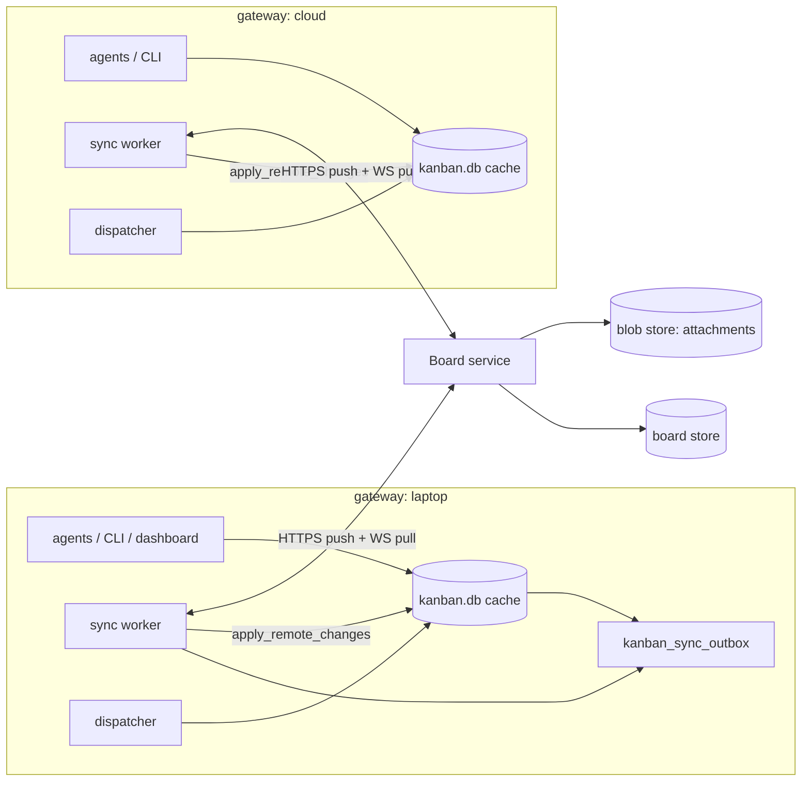
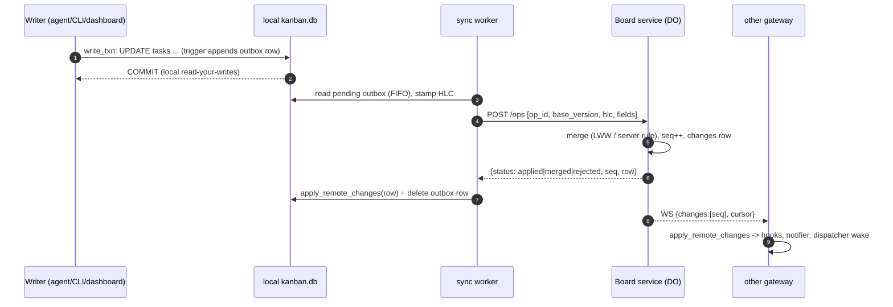

# Centralized Kanban board service (design)

Patch: proposed `0193` (core apply path) plus a client plugin and a cloud service. **Nothing here is built yet.**

Status: design / RFC, 2026-10-23. This doc describes no shipped behavior and claims nothing that tests prove. It
proposes making a cloud service the source of truth for Kanban boards, with every gateway's `kanban.db` kept as a
local SQLite cache that serves reads and accepts writes while offline.

All line references are to upstream `hermes-agent` at `07ee800d` (2026-10-22) unless a path starts with `plugins/`
or `core/` in this repo.

## Problem

A board is a SQLite file on one machine. `hermes_cli/kanban_db.py` L1–12 states the model: boards live under
`kanban_home()` (L400; `HERMES_KANBAN_HOME` or the Hermes root, shared by every profile on the host), each board is
`<root>/kanban/boards/<slug>/kanban.db` (`kanban_db_path` L562, `default` stays at `<root>/kanban.db`), and
concurrency is WAL plus `BEGIN IMMEDIATE` plus a compare-and-swap on `tasks.status`/`claim_lock`
(`hermes_cli/kanban_db_connect.py` `write_txn` L1241, `hermes_cli/kanban_db.py` `_claim_and_open_run` L2123). That
gives one writer per board, which is the whole correctness story for claims: "at most one concurrent writer
succeeds" (`write_txn` docstring).

With several gateways (laptop, mac-mini, a cloud gateway), each one has its own, unrelated boards:

- Patch 0090 ([kanban-all-gateways.md](kanban-all-gateways.md)) merges boards at view time in Desktop only
  (`apps/desktop/src/plugins/kanban/api.ts`: `mergeBoards`, `remoteRead`, `taskOwners`). Its Gotchas say it plainly:
  "Nothing is replicated. Each gateway keeps its own kanban.db". Upstream `api.ts` L11–12 still says "a board lives on
  ONE gateway". Agents, the CLI, the dispatcher and the notifier see only their own host.
- Agents reach other gateways' cards through `cross_task` (`plugins/session-mentions/__init__.py` L131–180), which
  writes a request file that the Desktop app relays (L1–6, `_relay` L191). It works only while Desktop is running, and
  it can list/read/comment only.
- A parent card cannot depend on a child that runs on another gateway: `task_links` (L879) holds plain local ids and
  `_parents_satisfied` (L2099) reads local rows.
- Moving a board is export/import (`hermes_cli/kanban_transfer.py`): `_scrub_local_state` (L70) strips claims, PIDs
  and notify subs, and an import always lands as a new board (`import_board` L287), so there is no shared history.

## Goals

- One logical board, visible and writable from every gateway, the CLI, agents and Desktop, with the same task ids
  everywhere.
- Every existing local reader keeps working unchanged: SQL against `kanban.db`, the dashboard REST plugin
  (`plugins/kanban/dashboard/plugin_api.py`), the WebSocket event tail (L1802), and this repo's plugins that open the
  file directly.
- Offline first: a gateway with no network keeps reading and writing its cache and converges when it reconnects.
- Claims stay exclusive across gateways. Two gateways must never run the same card at once.
- Cross-gateway dependencies (parent on laptop, child on the cloud gateway) work natively.
- Attachments are reachable from every gateway.
- The rollout is incremental and reversible (feature flag, shadow mode, one-command rollback to local-only).

## Non-goals

- Replicating sessions, `state.db`, transcripts or worker workspaces. Workspaces stay on the gateway that runs the
  card.
- Multi-tenant SaaS. This is one owner's boards, a handful of gateways and at most tens of thousands of cards.
- Real-time collaborative text editing of card bodies. Field-level last-writer-wins is enough.
- Replacing the dispatcher. Each gateway still runs its own embedded dispatcher
  (`gateway/kanban_watchers_dispatcher.py` `_KanbanDispatcher` L121) against its local cache.
- Peer-to-peer sync between gateways. A star topology around one service is much simpler to reason about for leases.

## Architecture



- **Service**: owns the canonical rows, assigns a monotonically increasing server sequence (`seq`) per board, grants
  claim leases and serves a change feed.
- **Local cache**: the existing `kanban.db`, schema unchanged except for added columns and tables (below). Every
  read stays local. Every write still commits locally first, in the same `write_txn`, and also appends an outbox
  row in that transaction.
- **Sync worker**: one per gateway, running in the gateway process beside the embedded dispatcher
  (`gateway/kanban_watchers.py` L258). It drains the outbox, holds a feed subscription per synced board, and applies
  remote changes through the new core entry point `kanban_db_sync.apply_remote_changes`.
- **Desktop**: talks to its active gateway exactly as today. Because every gateway's cache holds every synced board,
  the 0090 fan-out becomes unnecessary (see Migration).

### Option A: Cloudflare (recommended)

- **Workers** for the HTTP API: auth, request validation, routing to the board object.
- **One Durable Object per board**, using SQLite-backed storage (GA since 2025-04; 10 GB per object on Workers Paid,
  which is orders of magnitude above a board's size). A DO is single-threaded and strongly consistent, which mirrors
  today's single writer per board. Claim CAS, `seq` assignment and the feed all live in one object with no
  distributed locking. The DO's schema can be close to `SCHEMA_SQL`, so server logic can be ported from
  `kanban_db.py` instead of re-modelled.
- **Push** through the DO WebSocket Hibernation API (`ctx.acceptWebSocket`): idle boards cost nothing, and up to
  32,768 sockets per object is far beyond a few gateways. DO alarms handle lease expiry and tombstone GC.
- **D1** only for the small cross-board index: the board list, gateway registry and token hashes. Board data stays in
  the DOs.
- **R2** for attachments. Gateways upload and download through short-lived presigned URLs minted by the Worker.
- Ops: one `wrangler deploy`. There is no VPC, no connection pool, and no cold-start penalty on the hot path.

### Option B: AWS

- **API Gateway** (HTTP API for push and pull, WebSocket API for the feed) plus **Lambda**.
- **Aurora Serverless v2 (Postgres)**: one schema, a `board_id` column on every table, `SELECT … FOR UPDATE` or a
  conditional `UPDATE` for claims, and a per-board sequence. It is relational like `SCHEMA_SQL`. Costs: a VPC, RDS
  Proxy for Lambda connection storms, and a minimum ACU floor.
- **or DynamoDB**: one item per row with `pk=board#…`, conditional writes for claims, and Streams to fan out to
  WebSocket connections that are tracked in a table. It is cheap and serverless, but every relational read (links,
  `recompute_ready` on L2035, board listing) has to be re-modelled into access patterns, and the per-board total
  order needs an atomic counter item.
- **S3** for attachments, again with presigned URLs.
- Ops: IaC across about six services. The WebSocket fan-out needs a connection table, and push must be done by
  calling `postToConnection` from Lambda.

### Comparison

| Concern | Cloudflare Workers + DO | AWS Lambda + Aurora | AWS Lambda + DynamoDB |
|---|---|---|---|
| Per-board serialization (claims, `seq`) | native (single-threaded DO) | row locks / sequence | conditional writes + counter item |
| Schema reuse from `SCHEMA_SQL` | high (SQLite) | high (SQL) | low |
| Live push | DO WebSocket, hibernates | API GW WS + connection table | API GW WS + Streams |
| Idle cost | ~0 | ACU floor + proxy | ~0 |
| Ops surface | 1 deploy, 4 products | VPC, RDS Proxy, IaC | IaC, stream wiring |
| Cross-board queries | weak (fan-out to DOs; D1 index) | strong | weak |
| Vendor lock-in | DO API | low (Postgres) | high |

**Recommendation: Cloudflare.** The problem is "many small, independent, strictly ordered logs with exclusive
leases", and one Durable Object per board is exactly that primitive. The DO's SQLite keeps the server schema a near
copy of the client's, and hibernating WebSockets make live push essentially free. AWS + Aurora is the fallback if
cross-board SQL analytics or Postgres portability ever matter more. Keep the wire protocol (below)
backend-agnostic so that switching later costs one server rewrite and no client changes.

### Auth and tokens

- **Gateway identity**: each gateway registers once (`hermes kanban sync enroll`). Enrollment is approved from an
  already-enrolled device or with a one-time code, and it yields a `gateway_id` (ULID) plus a long-lived refresh
  token. The token is stored in the gateway's secret store (the same place provider keys live, never in
  `kanban.db`, never in this repo). Each request uses a short-lived access token (≈15 min JWT) that carries
  `gateway_id` and the board scopes.
- **Profile identity**: profiles share one board root per host (`kanban_home()` L400), so the gateway is the
  security principal and the profile is an attribution field (`created_by`, `author`, `task_runs.profile`). The
  service records which gateway wrote what (`origin_gateway`) but does not try to authenticate individual profiles.
- **Scopes**: `board:read`, `board:write` and `board:claim` per board. A read-only gateway (for example a phone
  companion) never gets `claim`.
- **Revocation**: deleting the gateway row in the D1 registry invalidates its refresh token. Its outstanding leases
  expire normally (see Claims).
- **Attachments**: the service never proxies bytes. It returns presigned R2/S3 URLs scoped to
  `boards/<board_id>/attachments/<attachment_uid>` that expire in 5 minutes.

## Data schema

### Current schema (verbatim, `hermes_cli/kanban_db.py` `SCHEMA_SQL` L775–981, column comments stripped)

```sql
CREATE TABLE IF NOT EXISTS tasks (
    id                   TEXT PRIMARY KEY,
    title                TEXT NOT NULL,
    body                 TEXT,
    assignee             TEXT,
    status               TEXT NOT NULL,
    priority             INTEGER DEFAULT 0,
    created_by           TEXT,
    created_at           INTEGER NOT NULL,
    started_at           INTEGER,
    completed_at         INTEGER,
    workspace_kind       TEXT NOT NULL DEFAULT 'scratch',
    workspace_path       TEXT,
    branch_name          TEXT,
    project_id           TEXT,
    claim_lock           TEXT,
    claim_expires        INTEGER,
    tenant               TEXT,
    result               TEXT,
    idempotency_key      TEXT,
    consecutive_failures INTEGER NOT NULL DEFAULT 0,
    worker_pid           INTEGER,
    worker_started_at    INTEGER,
    last_failure_error   TEXT,
    max_runtime_seconds  INTEGER,
    last_heartbeat_at    INTEGER,
    current_run_id       INTEGER,
    workflow_template_id TEXT,
    current_step_key     TEXT,
    skills               TEXT,
    model_override       TEXT,
    provider_override    TEXT,
    reasoning_effort     TEXT,
    max_retries          INTEGER,
    goal_mode            INTEGER NOT NULL DEFAULT 0,
    goal_max_turns       INTEGER,
    session_id           TEXT,
    block_kind           TEXT,
    block_recurrences    INTEGER NOT NULL DEFAULT 0
);

CREATE TABLE IF NOT EXISTS task_links (
    parent_id  TEXT NOT NULL,
    child_id   TEXT NOT NULL,
    PRIMARY KEY (parent_id, child_id)
);

CREATE TABLE IF NOT EXISTS task_comments (
    id         INTEGER PRIMARY KEY AUTOINCREMENT,
    task_id    TEXT NOT NULL,
    author     TEXT NOT NULL,
    body       TEXT NOT NULL,
    created_at INTEGER NOT NULL
);

CREATE TABLE IF NOT EXISTS task_events (
    id         INTEGER PRIMARY KEY AUTOINCREMENT,
    task_id    TEXT NOT NULL,
    run_id     INTEGER,
    kind       TEXT NOT NULL,
    payload    TEXT,
    created_at INTEGER NOT NULL
);

CREATE TABLE IF NOT EXISTS task_runs (
    id                  INTEGER PRIMARY KEY AUTOINCREMENT,
    task_id             TEXT NOT NULL,
    profile             TEXT,
    step_key            TEXT,
    status              TEXT NOT NULL,
    claim_lock          TEXT,
    claim_expires       INTEGER,
    worker_pid          INTEGER,
    worker_started_at   INTEGER,
    max_runtime_seconds INTEGER,
    last_heartbeat_at   INTEGER,
    started_at          INTEGER NOT NULL,
    ended_at            INTEGER,
    outcome             TEXT,
    summary             TEXT,
    metadata            TEXT,
    error               TEXT
);

CREATE TABLE IF NOT EXISTS task_attachments (
    id           INTEGER PRIMARY KEY AUTOINCREMENT,
    task_id      TEXT NOT NULL,
    filename     TEXT NOT NULL,
    stored_path  TEXT NOT NULL,
    content_type TEXT,
    size         INTEGER NOT NULL DEFAULT 0,
    uploaded_by  TEXT,
    created_at   INTEGER NOT NULL
);

CREATE TABLE IF NOT EXISTS kanban_notify_subs (
    task_id       TEXT NOT NULL,
    platform      TEXT NOT NULL,
    chat_id       TEXT NOT NULL,
    thread_id     TEXT NOT NULL DEFAULT '',
    user_id       TEXT,
    user_id_alt   TEXT,
    chat_type     TEXT,
    notifier_profile TEXT,
    delivery_mode TEXT NOT NULL DEFAULT 'notify',
    delivery_metadata TEXT,
    created_at    INTEGER NOT NULL,
    last_event_id INTEGER NOT NULL DEFAULT 0,
    last_ping_event_id INTEGER NOT NULL DEFAULT 0,
    PRIMARY KEY (task_id, platform, chat_id, thread_id)
);
-- indexes: idx_tasks_status, idx_links_child, idx_links_parent, idx_comments_task, idx_events_task,
--          idx_runs_task, idx_runs_status, idx_attachments_task, idx_notify_task
```

The idempotent column migrations in `kanban_db_connect.py` (`_BASE_TASK_COLUMNS` ~L820, the canonical
`CREATE TABLE`s L1058–1095) must keep matching. Patches in this repo add local tables
(`worker_recovery_sessions`, patch 0117) and derive state from `task_runs.metadata` (shared blockers, patch 0141,
"No schema change" in [kanban-shared-blockers.md](kanban-shared-blockers.md)). That derivation only works across
gateways if `task_runs` is synced.

### Identity: global ids without breaking local integer ids

`task_comments`, `task_events`, `task_runs` and `task_attachments` use `INTEGER PRIMARY KEY AUTOINCREMENT`, and
several things depend on those local integers being dense and monotonic:

- the notifier cursor `kanban_notify_subs.last_event_id` (`kanban_db_notify.py` L364 advances it under
  `BEGIN IMMEDIATE`);
- the dashboard WebSocket `since` cursor (`plugin_api.py` `stream_events` L1802);
- `tasks.current_run_id`, `task_events.run_id` and `HERMES_KANBAN_RUN_ID` in the worker env
  (`kanban_db_dispatch.py` L2833).

So the design **keeps the local integer `id` as a local surrogate** and adds a global `uid TEXT UNIQUE` (UUIDv7,
which is time-ordered and sorts like a ULID) to each of those tables. On the wire, rows are identified only by `uid`.
Integer cross-references (`run_id`, `current_run_id`) travel as `run_uid` and are translated to the local integer on
apply. A remote event therefore gets a fresh local `id` larger than every existing one, so every local cursor keeps
working without changes.

Task ids are already `TEXT`, but `_new_task_id` (L987) is `"t_" + secrets.token_hex(4)`: 32 bits, "collision ~1e-3
at 100k tasks", per gateway. Across gateways and offline creation that is not safe enough. New ids become
`t_` + 16 hex digits (64 bits, the first 48 of them a millisecond timestamp, so ids stay roughly sortable). Existing
`t_xxxxxxxx` ids are kept verbatim. The service rejects a colliding create with `409 id_taken`, and the client then
remaps (see Backfill). Links in chat (`@task:<board>/<task_id>`) keep working because ids never change once
accepted.

### Central schema (service side, per board)

Every synced table gains the same sync envelope:

```sql
-- added to tasks, task_links, task_comments, task_events, task_runs, task_attachments (server side)
uid             TEXT PRIMARY KEY,   -- tasks: = id ('t_…'); links: parent_id||'>'||child_id; others: UUIDv7
seq             INTEGER NOT NULL,   -- per-board server sequence of the LAST change to this row (feed cursor)
version         INTEGER NOT NULL,   -- bumps on every accepted change; used for optimistic concurrency
updated_at      INTEGER NOT NULL,   -- server wall clock, ms
hlc             TEXT NOT NULL,      -- hybrid logical clock of the winning write: '<ms:13>-<counter:4>-<gateway_id>'
origin_gateway  TEXT NOT NULL,      -- gateway_id that made the winning write
deleted_at      INTEGER             -- tombstone; NULL = live
```

`tasks` additionally keeps a per-field clock so concurrent edits to different fields both survive:

```sql
field_hlc       TEXT NOT NULL DEFAULT '{}'  -- JSON {column: hlc} for LWW-merged columns
lease_holder    TEXT,                       -- gateway_id holding the claim lease (server-only truth)
lease_run_uid   TEXT,
lease_expires   INTEGER                     -- server ms
```

The change log is the feed:

```sql
CREATE TABLE changes (
    seq         INTEGER PRIMARY KEY,         -- dense, per board (per DO)
    table_name  TEXT NOT NULL,
    row_uid     TEXT NOT NULL,
    op          TEXT NOT NULL,               -- 'upsert' | 'delete' | 'lease'
    fields      TEXT,                        -- JSON of changed columns AFTER merge (full row on insert)
    hlc         TEXT NOT NULL,
    origin_gateway TEXT NOT NULL,
    client_op_id TEXT,                       -- echo suppression + idempotency
    created_at  INTEGER NOT NULL
);
CREATE TABLE applied_ops (                   -- idempotency: replayed batch -> same result
    client_op_id TEXT PRIMARY KEY,
    result       TEXT NOT NULL,              -- JSON of the per-op response
    created_at   INTEGER NOT NULL            -- GC after 30 days
);
CREATE TABLE board_meta (key TEXT PRIMARY KEY, value TEXT);  -- board.json equivalent (name, archived, …)
```

**Columns that never leave the gateway.** They are machine-local, the same set `_scrub_local_state`
(`kanban_transfer.py` L70) already strips, plus a few more. They are stored locally and are neither pushed nor
overwritten by pulls:

| Table | Local-only columns | Why |
|---|---|---|
| `tasks` | `claim_lock`, `claim_expires`, `worker_pid`, `worker_started_at`, `last_heartbeat_at`, `workspace_path`, `session_id`, `project_id` | `host:pid` claimer (`_claimer_id` L993), local PIDs, local paths, local session ids. Lease state is synced through the server's `lease_*` columns instead. |
| `task_runs` | `claim_lock`, `claim_expires`, `worker_pid`, `worker_started_at`, `last_heartbeat_at` | same; the run's `status`, `outcome`, `summary`, `metadata`, `error`, `profile`, `step_key`, `started_at`, `ended_at` ARE synced |
| `task_attachments` | `stored_path` | absolute local path; the server stores `blob_key`, and the local path is filled in when the blob is fetched |
| `kanban_notify_subs` | the whole table | chat ids per gateway platform (and private); each gateway notifies its own chats |
| `worker_recovery_sessions` (0117) | the whole table | local transcript recovery |

`consecutive_failures` and `last_failure_error` ARE synced. Retry budgets are a property of the card, not of the
host, so a card that fails on one gateway must not get a fresh budget on another.

### Local additions (client side, in `kanban.db`)

```sql
ALTER TABLE task_comments    ADD COLUMN uid TEXT;  -- + UNIQUE index; same for task_events, task_runs, task_attachments
ALTER TABLE task_attachments ADD COLUMN blob_key TEXT;
ALTER TABLE tasks            ADD COLUMN sync_version INTEGER;  -- last server version seen (NULL = never synced)
ALTER TABLE tasks            ADD COLUMN field_hlc TEXT;        -- local per-field clocks (JSON)
ALTER TABLE tasks            ADD COLUMN lease_holder TEXT;     -- mirror of the server lease, read-only locally
ALTER TABLE tasks            ADD COLUMN lease_expires INTEGER;

CREATE TABLE kanban_sync_outbox (
    op_id       TEXT PRIMARY KEY,            -- UUIDv7 = idempotency key
    table_name  TEXT NOT NULL,
    row_uid     TEXT NOT NULL,
    op          TEXT NOT NULL,               -- 'upsert' | 'delete' | 'claim' | 'release' | 'heartbeat'
    fields      TEXT NOT NULL,               -- JSON: changed column -> new value (synced columns only)
    base_version INTEGER,                    -- row version the edit was made on
    hlc         TEXT NOT NULL,
    created_at  INTEGER NOT NULL,
    attempts    INTEGER NOT NULL DEFAULT 0,
    last_error  TEXT,
    state       TEXT NOT NULL DEFAULT 'pending'   -- 'pending' | 'inflight' | 'rejected'
);
CREATE INDEX idx_outbox_pending ON kanban_sync_outbox(state, created_at);

CREATE TABLE kanban_sync_tombstones (        -- rows deleted locally or remotely; the row itself is removed
    table_name  TEXT NOT NULL,
    row_uid     TEXT NOT NULL,
    deleted_at  INTEGER NOT NULL,
    PRIMARY KEY (table_name, row_uid)
);

CREATE TABLE kanban_sync_state (             -- one row per board file
    board_id      TEXT PRIMARY KEY,          -- server board id (ULID)
    cursor        INTEGER NOT NULL DEFAULT 0,-- last server seq applied
    gateway_id    TEXT NOT NULL,
    hlc_last      TEXT NOT NULL,             -- clock state, survives restart
    mode          TEXT NOT NULL,             -- 'off' | 'shadow' | 'primary'
    applying      INTEGER NOT NULL DEFAULT 0 -- 1 while apply_remote_changes runs (echo suppression)
);
```

**Capture by triggers, not by call sites.** Writes come from many places: `kanban_db.py` helpers, `plugin_api.py`
field editors doing direct SQL (the reason `notify_task_updated` L211 exists), CLI subprocesses (user-steps shells
out to `hermes kanban create`, `plugins/user-steps/cards.py` L1–5) and workers in other processes. Instrumenting
each call site would miss some. Instead, `init_db` (L804) installs `AFTER INSERT/UPDATE/DELETE` triggers on the
synced tables. The triggers write the synced columns into `kanban_sync_outbox` in the **same transaction** as the
change, which is the outbox pattern without any dual-write gap. Each trigger is guarded by
`WHEN (SELECT applying FROM kanban_sync_state) = 0` so remote applies do not echo. Triggers cannot compute an HLC,
so they store `hlc = ''`; the sync worker stamps the HLC when it drains the row, which is acceptable because the
outbox is FIFO per gateway, and the HLC only needs to be monotonic per gateway and above the last HLC observed from
the server.

## Sync protocol

Wire format: JSON over HTTPS. All timestamps are ms. `board_id` is in the path.

### Push (outbox drain)

`POST /v1/boards/{board_id}/ops` with up to 200 outbox rows in FIFO order:

```json
{"gateway_id": "01J…", "ops": [
  {"op_id": "0192…", "table": "tasks", "uid": "t_0192a1b2c3d4e5f6", "op": "upsert",
   "fields": {"title": "…", "priority": 2}, "base_version": 7, "hlc": "1761200000123-0003-01J…"}]}
```

The response has one entry per op: `{"op_id", "status": "applied"|"merged"|"rejected", "seq", "version", "row"}`.
`merged` means the server combined the op with a concurrent change, and `row` is the authoritative result, which
the client applies locally exactly like a pulled change. `rejected` carries a reason (`lease_lost`,
`illegal_transition`, `id_taken`, `forbidden`). The client marks those outbox rows `rejected`, applies `row` to
revert the local state, and writes a `sync_rejected` `task_event` so the board shows what happened.

The server treats `op_id` as the idempotency key (`applied_ops`), so a retried batch after a timeout returns the
same answers. Ops in one batch are applied in order. One op failing does not abort the batch, except that ops on the
same `uid` after a rejected op are also rejected (`depends_on_rejected`) so the per-row order is preserved.

### Pull (change feed)

- `GET /v1/boards/{board_id}/changes?after=<cursor>&limit=500` returns `{changes: [...], cursor, more}`.
- `GET /v1/boards/{board_id}/feed?after=<cursor>` upgrades to a WebSocket. The server first replays everything
  after `cursor`, then streams live changes: `{"type": "changes", "changes": [...], "cursor": N}`. It also sends
  `{"type": "lease", …}` frames and a `ping` every 30 s.
- SSE (`Accept: text/event-stream`) has the same semantics, for hosts whose proxies break WebSockets.
- Polling fallback: if the socket has been down for more than 10 s, poll `/changes` every 15 s (Desktop's 0090
  cadence) with backoff to 120 s, and keep trying to reconnect the socket.
- The client applies each page through `apply_remote_changes` and advances `kanban_sync_state.cursor` **in the
  same transaction**, so a crash replays at most one page, and replay is idempotent because changes are keyed by
  `(uid, version)`.
- If `after` is older than the server's compaction horizon, the server answers `410 resync`, and the client runs a
  snapshot resync: `GET /v1/boards/{id}/snapshot` streams the full board at a `seq`, the client rebuilds the synced
  tables (keeping local-only columns by uid) and then resumes the feed.



### Offline queue and reconnect

Offline, the outbox simply grows. Reads and writes are fully local, and the dispatcher keeps running cards that
the gateway **already holds leases for** (see Claims). On reconnect:

```mermaid
sequenceDiagram
  autonumber
  participant S as sync worker
  participant DB as local kanban.db
  participant SVC as Board service
  S->>SVC: refresh token, GET /changes?after=cursor (pull FIRST)
  SVC-->>S: remote changes since disconnect
  S->>DB: apply_remote_changes (local-pending fields win locally until their ops resolve)
  S->>SVC: POST /ops (drain outbox in batches)
  SVC-->>S: applied / merged / rejected per op
  S->>DB: apply authoritative rows; rejected -> revert + sync_rejected event
  S->>SVC: open WS feed after=cursor
```

Pulling before pushing keeps the per-field merge honest. While a row has pending outbox ops, an incoming change
for a field that is also pending locally is merged by HLC on the client, using the same rule the server will use,
so the UI does not flicker between values. The server's answer to the push is final either way.

## Conflicts

The policy is a hybrid: **operations whose correctness depends on a single winner are server-authoritative; field
edits are per-field LWW by HLC; append-only rows are a union.**

### Per-field LWW (HLC)

Columns: `title`, `body`, `assignee`, `priority`, `tenant`, `branch_name`, `workspace_kind`, `skills`,
`model_override`, `provider_override`, `reasoning_effort`, `max_retries`, `max_runtime_seconds`, `goal_mode`,
`goal_max_turns`, `workflow_template_id`, `current_step_key`, `idempotency_key`.

- The HLC is `(physical_ms, counter, gateway_id)`. It is updated on every local stamp and on every received change
  (`max(local, remote)`), so a gateway with a skewed clock still orders after anything it has seen. The server
  refuses HLCs more than 5 minutes ahead of its own clock (`clock_skew`) so one bad clock cannot win every future
  write.
- The server keeps `field_hlc[col]` and accepts a field only if the incoming HLC is greater. Edits to different
  fields of the same card both survive. This matters because the dashboard edits `title`/`body` while a worker's
  `complete_task` writes `result`.
- The alternative, whole-row optimistic concurrency (`base_version` must match, else reject), is simpler but turns
  every concurrent edit into a user-visible error. `base_version` is still sent, and the server uses it for the
  transition rules below.

### Server-authoritative operations

- **Status transitions** (`status`, `started_at`, `completed_at`, `result`, `block_kind`, `block_recurrences`,
  `consecutive_failures`, `last_failure_error`, `current_run_id`). These are not merged by LWW. The server
  validates each op as a transition from the row's current status, using the same state machine as `kanban_db.py`
  (`complete_task` L2639, `block_task` L3124, `unblock_task` L3560, `archive_task` L3792, `recompute_ready` L2035).
  An op that is illegal from the current state is rejected (`illegal_transition`). Example: an offline gateway
  archives a card that another gateway completed meanwhile. `archive` from `done` is legal and applies. `complete`
  from `archived` is rejected, and the run's summary is still kept as a comment. A `complete`/`block` op must carry
  the run uid of the lease holder (below).
- **`recompute_ready`** (todo → ready when parents are done) runs on the server after any status change, because
  only the server sees every parent. Gateways stop promoting locally for synced boards; they still run it for
  `mode='off'` boards.

### Append-only tables merge trivially

`task_comments`, `task_events` and `task_runs` (inserts) and `task_attachments` are keyed by a UUIDv7 `uid` that
the writer generates, so concurrent inserts never collide and the merge is a set union. Order for display is
`created_at, uid`. `task_runs` rows are updated in place only by the lease holder (end of run: `status`,
`ended_at`, `outcome`, `summary`, `metadata`, `error`), so they have a single writer by construction.
`task_links` is a set keyed by `(parent_id, child_id)`: add/remove ops with tombstones, add-wins on concurrent
add/remove.

### Deletes and tombstones

`delete_task` (L3857) hard-deletes locally today. For synced boards it becomes a tombstone (`deleted_at`): the
server records `op='delete'` in `changes`. Locally the row is still removed physically, the trigger records a delete
op plus a `kanban_sync_tombstones` row, and later pulls of a tombstoned uid are dropped. Rules:

- A delete beats a concurrent field edit (delete-wins), but not a concurrent **claim**. A card under a live lease is
  not deleted until the lease ends; the op returns `merged`, and the delete is applied after release.
- Children of a deleted task: links are tombstoned with it, and `_parents_satisfied` treats a deleted parent as
  satisfied (the same as today's local behavior after delete).
- Tombstones are GC'd after 90 days (DO alarm). A client whose cursor is older than that gets `410 resync`.

### Claims: server-granted leases

This is the part that has to be exactly right: **two gateways must never run the same card.** Today the guarantee
is the local CAS in `_claim_and_open_run` (L2123), which is exclusive only within one file. For synced boards:

1. The dispatcher's `claim_task` (L2170) keeps its local `write_txn`, but before the CAS it asks the service for a
   lease: `POST /v1/boards/{id}/leases {task_uid, run_uid, gateway_id, ttl_s}`. The DO grants it only if
   `lease_holder IS NULL OR lease_expires < now`, and the task is `ready` (or `review` for
   `claim_review_task`) with parents satisfied. The grant is a `lease` change in the feed, so every other gateway
   immediately mirrors `lease_holder` and its dispatcher skips the card.
2. Only after the grant does the local CAS run (`claim_lock = host:pid`, as now). The worker env is unchanged
   (`kanban_db_dispatch.py` L2812–2852).
3. `heartbeat_claim` (L2290) also renews the lease, rate-limited to once per `ttl/3`. The lease TTL defaults to
   the claim TTL. If renewal fails because the network is down, the worker keeps running until `lease_expires`
   minus a safety margin (60 s); then the dispatcher stops the worker exactly as it would for a stale claim
   (`on_kanban_worker_stale_claim`), and the run ends with `outcome='lease_lost'`.
4. `complete`/`block`/`release` ops carry `run_uid`. The server accepts them only from the current lease holder;
   from anyone else they are rejected with `lease_lost`, and the run's summary is preserved as a comment. This is
   the fencing token: a gateway that wakes up from a long sleep cannot overwrite the result of the gateway that
   re-ran the card.
5. Lease expiry on the server (DO alarm) returns the card to `ready` and appends a `reclaimed` event, mirroring
   `reclaim_task` (L2474), so a dead gateway never strands cards.

**Offline claims are not allowed.** A gateway without a lease cannot start a card on a synced board; the dispatcher
logs `claim_deferred: offline` and leaves the card `ready`. Cards already running when the network drops continue
until their lease runs out (step 3). This trades availability for safety, deliberately: running a card twice can
double-push a branch or double-send a message, while waiting only delays work. A per-board setting
`offline_claims: "local-only"` could later allow claiming cards whose `assignee` profile exists only on this
gateway, but that is an open question, not part of v1.

**Cross-gateway dependencies become possible.** Because `task_links` and every task's status replicate, a parent
on the laptop board can depend on a child that the cloud gateway runs. The server's `recompute_ready` promotes the
parent when the child completes, the promotion arrives as a change, and the laptop's dispatcher, woken by the
apply path, claims it. No relay is needed.

## Apply path (proposed core patch `0193`)

Remote changes have to enter `kanban.db` in a way that keeps local invariants and observers working. Plugin hooks
(`hermes_cli/plugins.py` L157–181) are fired **after commit**, "so a slow plugin never holds the SQLite write lock",
by whichever process drove the transition (`_fire_task_hook` L165, `notify_task_updated` L211: "field NAMES only,
never values"). A remote completion has no local driver, so without a core entry point nothing would fire
`kanban_task_completed`, the notifier would see the new `task_events` row only on its next tail (that part works,
since the notifier tails `task_events` by local id), and the dispatcher would wait out its 60 s tick
(`dispatch_interval_seconds`, `gateway/kanban_watchers_dispatcher.py` L50).

New module `hermes_cli/kanban_db_sync.py` (core, patch 0193):

```python
@dataclass(frozen=True)
class RemoteChange:
    seq: int
    table: str                      # 'tasks' | 'task_links' | 'task_comments' | 'task_events' | 'task_runs' | 'task_attachments' | 'board_meta'
    uid: str
    op: str                         # 'upsert' | 'delete' | 'lease'
    fields: Mapping[str, Any]       # synced columns only; run_uid instead of run_id
    version: int
    hlc: str
    origin_gateway: str
    client_op_id: Optional[str]     # set when this is our own op coming back

@dataclass
class ApplyResult:
    cursor: int
    applied: int
    skipped_echo: int
    hooks: list[tuple[str, str, dict]]     # (event, task_id, kwargs) to fire after commit
    changed_fields: dict[str, set[str]]    # task_id -> field names, for on_kanban_task_updated
    wake_dispatcher: bool                  # a task became ready / a lease was released
    blobs_to_fetch: list[str]              # attachment uids whose bytes are not local yet

def apply_remote_changes(conn: sqlite3.Connection, board: str, changes: Sequence[RemoteChange], *,
                         new_cursor: int, own_gateway_id: str) -> ApplyResult:
    """Apply one feed page atomically, then fire local observers.

    Inside ONE write_txn(conn):
      - set kanban_sync_state.applying = 1 (outbox triggers are suppressed -> no echo)
      - per change: skip if (uid, version) already applied; translate run_uid -> local run id
        (insert-or-lookup by uid); upsert synced columns only, never the local-only columns;
        tombstone on 'delete'; mirror lease_holder/lease_expires on 'lease'
      - if the change is our own op (client_op_id in outbox): delete that outbox row
      - detect transitions by comparing the old status with the new one and collect the matching hooks
        (claimed/completed/blocked) + changed_fields
      - if a lease moved away from this gateway while a local worker holds claim_lock -> mark it for
        stop (the dispatcher's stale-claim path does the kill)
      - advance kanban_sync_state.cursor = new_cursor; set applying = 0
    After COMMIT (never inside the txn, same rule as _fire_kanban_lifecycle_hook L153):
      - _fire_kanban_lifecycle_hook for each collected event, with origin_gateway=... in kwargs
      - notify_task_updated(conn, task_id, fields) per task
      - if wake_dispatcher: wake the embedded dispatcher (an asyncio.Event the tick loop also awaits)
      - enqueue blob fetches
    """
```

Notes on the interface:

- It must run in a fresh `write_txn` (no `allow_nested`), for the reason the `write_txn` docstring gives: helpers
  with post-commit side effects must never run under an outer transaction.
- Hook kwargs gain `origin_gateway` (and `remote=True`), so a plugin can tell "a card completed here" from "a card
  completed elsewhere". Existing plugins ignore extra kwargs. Plugins that react to `kanban_task_claimed` by
  touching the workspace (worktree setup, see [kanban-worktree-validation.md](kanban-worktree-validation.md)) must
  check `remote` and skip, because the workspace is on another host. This is the main behavioral change for
  plugin authors.
- The dispatcher wake replaces neither the tick nor the `POST /dispatch` nudge (`plugin_api.py` L1269). It just
  avoids a 60 s delay after a remote promotion.
- The trigger guard plus the `applying` flag is the only echo suppression needed. `client_op_id` matching also
  cleans the outbox when our own op returns through the feed before the POST response does.
- `init_db` (L804) gains the sync tables and triggers behind `kanban.sync.enabled`. With the flag off, no triggers
  are installed and nothing changes.

Patch 0193 contents: `kanban_db_sync.py`; trigger and table creation in `kanban_db_connect.py`; the lease call in
`claim_task`/`claim_review_task`/`heartbeat_claim`; tombstoning in `delete_task`; the wider `_new_task_id`; the
`remote`/`origin_gateway` hook kwargs; and a dispatcher wake event in `gateway/kanban_watchers_dispatcher.py`. The
sync worker itself (HTTP, WebSocket, auth, outbox drain) can live in a plugin in this repo (`plugins/kanban-sync/`)
on top of those core seams, which keeps the core patch small.

## Migration

### Plugins in this repo that open `kanban.db` directly

- `plugins/follow-through/core.py`: `kanban_dbs()` (L54–56) globs `home/kanban.db` + `kanban/boards/*/kanban.db`,
  and `_ro_connect` (L59–70) / `_ro` (L72) open read-only with the `mode=rw` + `query_only` fallback that
  `tests/test_sqlite_ro_guard.py` explains. It reads `kanban_notify_subs`, `tasks` and `task_events`.
- `plugins/user-steps/cards.py`: `boards()` (L22–26) does the same glob; `board_of` and `subscriptions` read `tasks`
  and `kanban_notify_subs`; writes go through the `hermes` CLI.

Options:

1. **Keep reading the local cache read-only (recommended for v1).** The cache is a full replica of every synced
   board, with the same tables and the same columns, so both plugins keep working without edits.
   - What changes:
     - Cards created on other gateways now appear. follow-through's `open_followups` filters on this gateway's
       `kanban_notify_subs`, which stay local, so it still reports only the chats it should.
     - `task_events.id` ordering is local arrival order, not global creation order. follow-through's
       `ORDER BY id DESC LIMIT 1` for the latest `completed` event is still right per task, because one task's
       events arrive in order.
     - Tombstoned tasks are removed physically from the cache (the tombstone lives in
       `kanban_sync_tombstones`, see Deletes), so `SELECT * FROM tasks WHERE id=?` returns nothing, as it does
       today after a local delete.
   - What breaks: nothing, as long as the board files keep their paths. A synced board's local file stays at
     `kanban_db_path(slug)` (L562). A rename of the path layout would break both globs.
2. **Move them to a client API** (`hermes_cli.kanban_db` read helpers, or the dashboard REST plugin). This is
   cleaner long-term and drops the duplicated `_ro_connect`, but it is not required by this design. Do it when the
   next change touches them.

user-steps' writes go through `hermes kanban create`/update/archive, so they pass the triggers and sync with no
change.

### Patch 0090 (Desktop all-gateways merge)

Once every gateway's cache holds every synced board, `GET /board` on the active gateway already returns all cards.
So 0090's fan-out (`mergeBoards`, `mergeBoardLists`, `remoteRead`, the 6 s read deadline and the 60 s cool-down) is
retired for synced boards. What stays:

- the device glyph per card, now driven by `lease_holder`/`origin_gateway` ("runs on") instead of "which gateway
  answered";
- the gateway filter, now a client-side filter on those fields;
- `taskOwners` routing for writes, which goes away because any gateway accepts any write.

During the transition, Desktop keeps the 0090 path for boards that are not synced (`mode='off'`) and must dedupe
by task id when two gateways return the same synced card. The current merge would show it twice. The
[kanban-all-gateways.md](kanban-all-gateways.md) doc and `api.gateways.test.ts` are updated with that phase.

### `cross_task` (session-mentions)

For synced boards, `cross_task list/read/comment` is replaced by the local `kanban_show`/`kanban_comment` tools,
because the card is in the local cache. `cross_task` becomes a thin wrapper: it resolves
`@task:<board>@<gateway>/<id>` by dropping `@<gateway>` when the board is synced and calling the local tools, and
it falls back to the Desktop relay (`_relay` L191) only for unsynced boards. Task links with a gateway part keep
resolving. Cross-session messaging (`cross_session`) is unaffected.

### Impact on the 22 `core/kanban-*.md` features

Most are local behavior on top of the same rows and need no change:

- UI-only: board-hotkey, toast-status-icon, blocked-sidebar, escalated-triage-red, drop-attachments (the upload
  path gains an R2 put, which the sync plugin does in the background).
- Dispatcher/worker-local: macos-worker-start-time, worker-worktree-cleanup, worktree-validation,
  complete-rejection-class.
- Notification-local: unloaded-session-delivery, notice-refusal-rewind, session-links and open-task-hook (both
  local session ids).

These need review:

- **park-invariants, timed-waits, soft-deadline, pr-unblock, block-instructions, block-loop-escalation,
  goal-handoff-judge**: they encode transition rules (who may move a card where, when a parked card wakes). The
  server's transition validator must implement the same rules, or reject less than the local code does. Timers
  (timed waits, soft deadlines) must fire on exactly one gateway. The proposal is that the server's DO alarm owns
  board-level timers for synced boards, and local timers only for `mode='off'`.
- **shared-blockers**: blocker state is derived from `task_runs` history. It works across gateways once runs sync,
  and the single "probe" card is exactly a lease, so it becomes more correct.
- **all-gateways**: retired as described above.

### Phased rollout

| Phase | What | Exit criteria | Effort |
|---|---|---|---|
| 0. Service skeleton | Worker + per-board DO with schema, `/ops`, `/changes`, WS feed, leases, auth/enroll, R2 presign; conformance tests that replay `kanban_db.py` transition tests against the DO | transition tests green against the service | 1.5–2 wk |
| 1. Core seams (patch 0193) | triggers + outbox + sync_state, `apply_remote_changes`, lease hooks in claim/heartbeat, tombstone delete, wider ids, hook kwargs, dispatcher wake; all behind `kanban.sync.enabled` (default off) | full upstream kanban test suite green with the flag off and on (no server: outbox only) | 1.5 wk |
| 2. Backfill + shadow | `hermes kanban sync import <board>` uploads a board (ID remap on collision); `mode='shadow'`: outbox drains and the feed is applied into a **separate** shadow file, never into the live board; a nightly diff job compares live vs shadow | 7 days of zero unexplained diffs on two gateways | 1 wk + soak |
| 3. Cutover per board | `mode='primary'`: leases are enforced and the feed applies into the live `kanban.db`; Desktop dedupes synced boards; `cross_task` wrapper; server owns timers | one board on all gateways for 7 days with no double-run (leases audited from `changes`) | 1 wk + soak |
| 4. Cleanup | retire the 0090 fan-out for synced boards, move follow-through/user-steps to helpers (optional), update the affected `core/kanban-*.md` docs | docs claim only what tests prove | 0.5–1 wk |

Total: about 6–7 weeks of focused work plus two soak periods.

**Backfill / import with ID remapping.** `sync import` reads the local board like `export_board` (L114) but keeps
history (no scrub of synced columns; it scrubs only the local-only columns listed above). It assigns `uid`s to
every comment, event, run and attachment row, rewrites `run_id`/`current_run_id` to `run_uid`, and uploads in
`seq` order. Task ids are kept. On `id_taken` (another gateway already imported that id), the importer remaps
`t_old → t_new` across `tasks.id`, `task_links`, every `task_id` column, and `kanban_notify_subs` locally. It
appends a `renumbered` event (`{"from": "t_old"}`) so links in old chats can still be resolved by a redirect lookup,
which `kanban_show` checks on a miss. Importing the same board from two gateways is the merge case; the second
import becomes a set of creates for the ids that do not exist yet, and conflicting ids are remapped.

**Feature flag.** `kanban.sync.enabled` (global) plus `kanban_sync_state.mode` per board (`off` → `shadow` →
`primary`). With the flag off, no triggers are installed and the code paths are identical to today.

**Rollback.** `hermes kanban sync detach <board>` sets `mode='off'`, drops the triggers for that board, releases
the leases it holds, and leaves `kanban.db` as a normal, complete local board, because the cache was always a full
board. Any un-drained outbox rows are kept in the file and reported. Re-attaching later reconciles them through the
normal push.

## Open questions

- Offline claims for profiles that exist on only one gateway (`offline_claims: "local-only"`): is the availability
  gain worth a second claim mode?
- Should `body` and `result` (long text) use a text CRDT instead of LWW? This design says no: card bodies are
  rarely co-edited.
- Timers on the server (DO alarms) mean the server must understand timed waits and soft deadlines. Alternatively,
  one gateway could be elected the "timer owner" per board, holding a lease on a pseudo-task.
- Board-level settings in `board.json` (display name, archived flag; `kanban_db.py` L372, L435): sync them as
  `board_meta` LWW, or keep them local?
- Retention: how long to keep `changes` before compaction, given that snapshot resync is cheap for boards of this
  size?
- Should the dashboard REST plugin (`plugin_api.py`) expose sync status per card ("pending push", "rejected")? It
  probably should, as a `sync_state` field on `GET /board` (L359).
- Should non-owner devices (phone, read-only companion) talk to the service directly, or only through a gateway?

## Risks

- **Double run through a lease bug.** This is the worst failure. Mitigation: fencing by `run_uid` on every
  terminal op, server-side audit of overlapping leases from `changes`, and a phase 3 soak with alerts.
- **Trigger drift.** A new column added by an upstream migration is not captured until the trigger list is
  updated. Mitigation: generate triggers from `PRAGMA table_info` minus the local-only set at `init_db` time, and
  add a test that fails when a `tasks` column is neither synced nor declared local.
- **Upstream churn.** `kanban_db*.py` changes often, and patch 0193 touches claim, heartbeat and delete. Keep the
  patch to seams (one call per site) and put the logic in `kanban_db_sync.py` to keep rebases cheap.
- **Clock skew.** Bounded by the HLC plus the server's 5-minute skew guard. Lease expiry uses server time only.
- **Behavior divergence between the server's transition validator and `kanban_db.py`.** Mitigation: phase 0's
  conformance suite runs the same transition cases against both.
- **Privacy.** Card bodies, results and comments move off-host into a cloud store. Chat ids (`kanban_notify_subs`)
  and local paths never leave. Encrypt at rest (the platform default) and consider client-side encryption of
  `body`/`result`/comments as a follow-up. Access tokens live in the gateway secret store only.
- **Service outage.** Gateways degrade to local-only for reads and edits, running cards finish within their lease,
  and new claims pause. This is visible to the user as cards that stay `ready`. The dashboard should show a
  "sync offline" chip.

## Code

None yet. Proposed: `hermes_cli/kanban_db_sync.py` + seams (core patch 0193), `plugins/kanban-sync/` (sync
worker, enroll/import/detach CLI), and a separate service repo (Worker + Durable Object).

## Tests

None yet. Required before any feature doc claims behavior: the upstream kanban suite with sync on and off; the
apply-path tests (echo suppression, run uid translation, hooks fire once after commit, cursor advances
atomically); lease tests (two gateways race, lease expiry mid-run, a stale holder's `complete` rejected); offline
replay (outbox survives restart, idempotent re-POST); and the import/remap tests.

## Gotchas

- Do not sync `kanban_notify_subs`: it holds chat ids and is per-gateway by nature. Each gateway notifies its own
  subscribers from its own copy of `task_events`.
- Local integer ids (`task_events.id`, `task_runs.id`) differ between gateways for the same row. Never put them on
  the wire, in links, or in anything another gateway reads; use `uid`.
- `delete_task` on a synced board is a tombstone. A card deleted on one gateway disappears everywhere, which is a
  bigger blast radius than today's per-host delete.
- A remote `kanban_task_claimed` hook means "claimed on another gateway". Plugins that set up workspaces must
  check `remote`.
